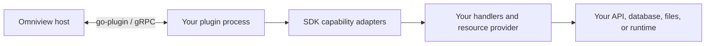

# Build an Omniview plugin

Use the Go SDK to expose resources, terminals, logs, metrics, forwarding, and tools from your backend.

> [!IMPORTANT]
> These guides describe the resource-v2 contract for SDK v0.9. Adopt it with the coordinated Omniview v0.11 and rebuilt plugin releases. This is a breaking resource migration, not a compatibility layer for resource-v1 plugins.

## Start here

**[Build your first resource plugin →](quickstart.md)**

Create a read-only notes plugin, run it locally, and see an exact-value resource read succeed. No Kubernetes cluster, credentials, or running host are needed for the local smoke.

## Choose your next task

| I want to… | Read |
| --- | --- |
| Choose which SDK capabilities my plugin exposes | [Plugin anatomy and capabilities](capabilities.md) |
| Add a resource type, point reads, or source pages | [Expose resources](resources.md) |
| Add a schema-validated, non-resource tool | [Expose a custom tool](tools.md) |
| Open native clients and handle connection shutdown | [Manage connections](connections.md) |
| Look up interfaces, request types, and return contracts | [Resource API reference](resource-v2-api.md) |
| Move an existing resource plugin to v2 | [Migrate from resource v1](sdk-v1-v2-overview.md) |
| Configure internal runtime logging | [Internal logging](internal-logging.md) |

## Where your code runs



The SDK supplies the process boundary and capability contracts. Your provider translates native data and operations. The host supplies trusted authority, authorization, and application behavior.

“Native” means **your backend**, not Kubernetes. Resource types and scope dimensions are provider-defined.

## Working example

[`examples/resource-plugin`](../examples/resource-plugin) is a complete plugin entrypoint plus a local smoke harness:

```text
examples/resource-plugin/
├── main.go            # smoke mode or SDK registration and serving
├── provider.go        # catalog and Get callback
├── plugin.yaml        # plugin metadata
└── data/welcome.json  # immutable source document
```

The [quickstart](quickstart.md) walks through these files and their expected output. The [resource guide](resources.md) shows how to extend the provider without advertising unsupported operations.

## Deeper contracts and review status

Most authors should start with the guides above. Use these when working on host integration or reviewing the candidate API:

- [Advanced resource contracts](resource-v2-contracts.md): admission, mutable ownership, utility lifetimes, and transport bounds.
- [Provider-neutral conformance](provider-neutral-conformance.md): executable boundary coverage and its limits.
- [Specification and acceptance review](resource-v2-spec-review.md): current contract choices, historical review context, and dated verification receipts.
- [MCP integration landing plan](mcp-v2-integration-plan.md): source-linked SDK, host, and Kubernetes work catalog and evidence; not release approval.
- [Implementation review](resource-v2-code-review.md): historical findings and organization rationale.

These review records are not the plugin-writing tutorial. Known constraints are called out at the relevant guide or reference section.
