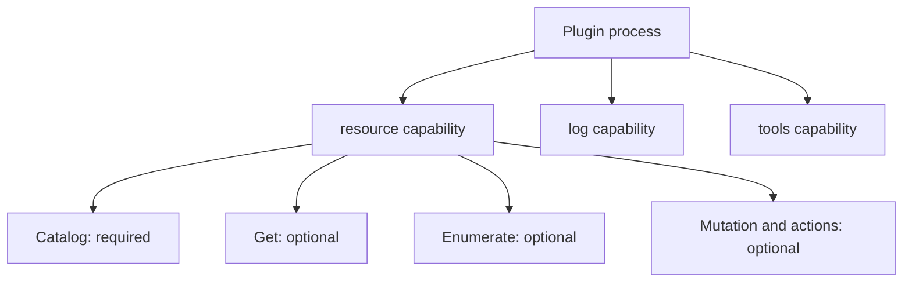

# Plugin anatomy and capabilities

[Docs home](README.md) · [Quickstart](quickstart.md) · [Resource API](resource-v2-api.md)

A Go backend plugin is an executable with metadata and one or more registered capabilities. Register capabilities before calling `Serve`. This guide covers backend authoring; frontend bundles and UI-component loading belong to the host integration.

## The three pieces

| Piece | What you write | SDK entrypoint |
| --- | --- | --- |
| Metadata | `plugin.yaml`: ID, version, name, and declared capabilities | `sdk.NewPlugin(sdk.PluginOpts{ID: "notes"})` reads the installed manifest. |
| Implementation | Resource provider or capability handlers | Register the implementations you actually support. |
| Process | A `main` function | `plugin.Serve()` starts the SDK's go-plugin/gRPC server. |

**Manifest ID and `PluginOpts.ID` must match.** The SDK reads the manifest from the selected state root's `plugins/<id>/plugin.yaml`, not an arbitrary working-directory file. The host owns installation and process launch; see [quickstart: installation and launch](quickstart.md#installation-and-launch-boundary).

## Choose capabilities

| Capability | Author entrypoint | What it adds |
| --- | --- | --- |
| Resources | [`sdk.RegisterResourcePlugin`](../pkg/sdk/plugin.go) | Catalog plus independently supported resource operations. |
| Exec | [`exec.RegisterPlugin`](../pkg/v1/exec/plugin.go) | Terminal/session handlers. |
| Logs | [`logs.RegisterPlugin`](../pkg/v1/logs/plugin.go) | Log handlers and source resolvers. Registered capability name is `log`. |
| Metrics | [`metric.RegisterPlugin`](../pkg/v1/metric/plugin.go) | Query, polling, and streaming handlers. |
| Forwarding | [`networker.RegisterPlugin`](../pkg/v1/networker/plugin.go) | Resource or static port-forward handlers. |
| Tools | [`tools.RegisterPlugin`](../pkg/v1/tools/plugin.go) | Named tools with schemas, scope, and result content. |
| Commands | [`command.RegisterPlugin`](../pkg/v1/command/plugin.go) | Opaque target/payload command dispatch. |
| Settings | `sdk.NewPlugin` and `PluginOpts.Settings` | Registered automatically; exposes settings and validation. |
| Lifecycle | `plugin.Serve()` | Registered automatically; exposes plugin identity, protocol, and capabilities. |

The utility `RegisterPlugin` helpers above return errors; check them. `RegisterResourcePlugin` does not return an error and rejects nil arguments by panicking. Host support and UI integration are separate from registering a Go implementation.

Package names such as `pkg/v1/exec` remain current utility paths. They do not mean that those calls use the removed resource-v1 contract.

## Register a resource provider

From [`main.go`](../examples/resource-plugin/main.go), after constructing the example's provider:

```go
plugin := sdk.NewPlugin(sdk.PluginOpts{ID: pluginID})
sdk.RegisterResourcePlugin(plugin, provider)
plugin.Serve()
```

This is a contextual excerpt: `pluginID` is `"notes"` and `provider` is the result of `newProvider` in the runnable example. `sdk.NewPlugin` also initializes settings and process logging. Do not print arbitrary output to stdout while serving: go-plugin uses it for its process protocol. The example prints its checkpoints only in `--smoke` mode.

## Resource operations are not separate plugin capabilities

Register **one** resource provider. Within its catalog, advertise only the resource operations each type and scope supports.



You do not register a new go-plugin service for each resource type or mutation verb. The resource transport dispatches operations to the provider.

## Share connection ownership

When the resource provider supplies `ConnectionContextProvider`, SDK registration binds compatible utilities to that provider's connection registry. Do not create a second native-client registry just for logs, exec, or metrics.

Reference-bearing utility work requires its accepted catalog observation. Body-only or opaque utility work does not need a fabricated reference or catalog pin. An explicit route still requires the selected configured connection. Accepted sessions have utility-specific lifetimes; [manage connections](connections.md) before adding these integrations.

## Next

- [Expose a resource type and implement Get](resources.md).
- [Manage native clients](connections.md).
- [Look up the resource API surface](resource-v2-api.md).
