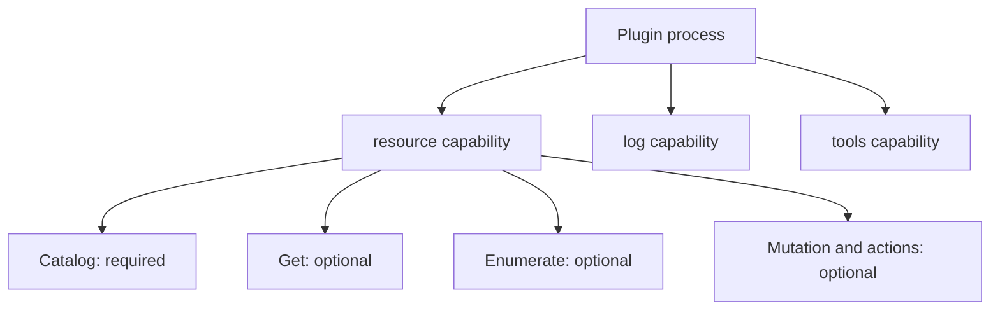

# Plugin anatomy and capabilities

[Docs home](README.md) · [Quickstart](quickstart.md) · [Resource API](resource-v2-api.md)

A Go backend plugin is an executable with metadata and one or more registered capabilities. Register capabilities before calling `Serve`. This guide covers backend authoring; frontend bundles and UI-component loading belong to the host integration.

## The three pieces

| Piece | What you write | SDK entrypoint |
| --- | --- | --- |
| Metadata | `plugin.yaml`: ID, version, name, and declared capabilities | `sdk.NewPlugin(sdk.PluginOpts{ID: "notes"})` reads the installed manifest. |
| Implementation | Resource provider or capability handlers | Register the implementations you actually support. |
| Process | A `main` function | `plugin.Serve()` starts the SDK's go-plugin/gRPC server. |

**Manifest ID and `PluginOpts.ID` must match.** The SDK reads the manifest from the selected state root's `plugins/<id>/plugin.yaml`, not an arbitrary working-directory file. The host owns installation and process launch; see [quickstart: installation and launch](quickstart.md#installation-and-launch-boundary).

## Choose capabilities

| Capability | Author entrypoint | What it adds |
| --- | --- | --- |
| Resources | [`sdk.RegisterResourcePlugin`](../pkg/sdk/plugin.go) | Catalog plus independently supported resource operations. |
| Exec | [`exec.RegisterPlugin`](../pkg/v1/exec/plugin.go) | Terminal/session handlers. |
| Logs | [`logs.RegisterPlugin`](../pkg/v1/logs/plugin.go) | Log handlers and source resolvers. Registered capability name is `log`. |
| Metrics | [`metric.RegisterPlugin`](../pkg/v1/metric/plugin.go) | Query, polling, and streaming handlers. |
| Forwarding | [`networker.RegisterPlugin`](../pkg/v1/networker/plugin.go) | Resource or static port-forward handlers. |
| Tools | [`tools.RegisterPlugin`](../pkg/v1/tools/plugin.go) | Named tools with schemas, scope, and result content. |
| Commands | [`command.RegisterPlugin`](../pkg/v1/command/plugin.go) | Opaque target/payload command dispatch. |
| Settings | `sdk.NewPlugin` and `PluginOpts.Settings` | Registered automatically; exposes settings and validation. |
| Lifecycle | `plugin.Serve()` | Registered automatically; exposes plugin identity, protocol, and capabilities. |

The utility `RegisterPlugin` helpers above return errors; check them. `RegisterResourcePlugin` does not return an error and rejects nil arguments by panicking. Host support and UI integration are separate from registering a Go implementation.

Package names such as `pkg/v1/exec` remain current utility paths. They do not mean that those calls use the removed resource-v1 contract.

Connection-scoped custom tools require `tools.CallInput.Route` with an explicit,
nonempty resource-v2 `AccessRoute.Connection`. The body route may select a
connection without metadata; selected connection metadata, when present, must
match. The SDK binds tools to the resource provider's sole native registry and
replaces caller profile data with the configured connection under a generation
lease. Unknown, unstarted, or retired connections fail closed; cancellation or
retirement prevents a late handler result from being accepted. Opaque tools do
not require or fabricate resource catalog pins. Plugin-scoped tools accept
neither a route nor selected connection metadata and need no registry.

Callers that previously supplied only connection metadata must migrate with the host: the SDK does not infer a missing body route. The handler still receives its admitted `PluginContext`; it does not construct a protobuf request or create a second client registry.

Custom tools use only the `omniview.sdk.tools.v2` RPC namespace. Discovery and
calls require contract version 2; there is no legacy namespace or metadata-route
fallback. The SDK client negotiates discovery before dispatching a call.

Tool schemas use JSON Schema 2020-12. Registration validates declarations;
arguments are validated before native connection admission or handler work, and
declared structured outputs are validated before success. Numbers remain exact
JSON numbers, and duplicate JSON members are rejected recursively. References
must be local fragments. Other dialects, resource `$id` declarations, and all
`format` keywords are rejected; express supported assertions with explicit
constraints. Schema defaults and coercion are never applied. External reference
loading is disabled.
Input and declared output schemas require an object root. Structured content,
when present, must be a JSON object even without an output schema.

Tools accept a bounded JSON Schema 2020-12 profile, not arbitrary recursive
schemas. Static local JSON-pointer and anchor references remain supported;
cyclic references and dynamic/legacy recursive references or anchors are rejected.
Legacy `dependencies`, `definitions`, `additionalItems`, and tuple-form `items`
are rejected; use `dependentRequired`, `dependentSchemas`, `$defs`, and
`prefixItems`. Preflight counts
expanded static schema edges (including unused definitions) and declaration
nodes before compiling. Their combined cost must not exceed 10,000. Before
validation, this cost multiplied by the square of the instance node count must
not exceed 1,000,000; the conservative square covers pairwise assertions such as
`uniqueItems`. Unsupported work is rejected, never silently skipped.

Each schema or JSON value is limited to 1 MiB, 10,000 value nodes, and nesting
depth 128. Numeric tokens are limited to 4,096 characters and exponent magnitude
4,096. Exact rational parsing must succeed before schema arithmetic; no float64
conversion, rounding, or coercion occurs. These limits apply to declaration data
and structured results as well as arguments.
Count assertions (`minLength`, `maxLength`, `minItems`, `maxItems`,
`minProperties`, `maxProperties`, `minContains`, `maxContains`) must be exact
nonnegative integers representable by the runtime's platform `int`; larger
declarations are rejected before compilation rather than overflowing.

Annotation fields are optional `*bool` values. Use `Annotations.Resolve()` for
effective MCP hints: read-only false, destructive true, idempotent false, and
open-world true. Explicit false remains false. These hints never grant access.

Handler errors and `IsError` results expose only a fixed safe message and a
reviewed `ErrorCode`: `EXECUTION_FAILED`, `UNAVAILABLE`, or `PERMISSION_DENIED`.
Unknown codes become `EXECUTION_FAILED`. Raw error text, failure content, and
failure structured content never cross the tools result boundary. Keep diagnostic
details in local logs, not model-facing content.
Cancellation and deadline failures retain transport error semantics rather than
becoming successful RPCs containing tool failures. Reviewed unavailable and
permission-denied handler errors retain their safe classification.

## Register a resource provider

From [`main.go`](../examples/resource-plugin/main.go), after constructing the example's provider:

```go
plugin := sdk.NewPlugin(sdk.PluginOpts{ID: pluginID})
sdk.RegisterResourcePlugin(plugin, provider)
plugin.Serve()
```

This is a contextual excerpt: `pluginID` is `"notes"` and `provider` is the result of `newProvider` in the runnable example. `sdk.NewPlugin` also initializes settings and process logging. Do not print arbitrary output to stdout while serving: go-plugin uses it for its process protocol. The example prints its checkpoints only in `--smoke` mode.

## Resource operations are not separate plugin capabilities

Register **one** resource provider. Within its catalog, advertise only the resource operations each type and scope supports.



You do not register a new go-plugin service for each resource type or mutation verb. The resource transport dispatches operations to the provider.

## Share connection ownership

When the resource provider supplies `ConnectionContextProvider`, SDK registration binds compatible utilities to that provider's connection registry. Do not create a second native-client registry just for logs, exec, metrics, or custom tools.

Reference-bearing utility work requires its accepted catalog observation. Body-only or opaque utility work does not need a fabricated reference or catalog pin. An explicit route still requires the selected configured connection. Accepted sessions have utility-specific lifetimes; [manage connections](connections.md) before adding these integrations.

Resource logs use the existing session engine. An optional UUID correlates
acceptance with cleanup; it is not an authority token, readiness acknowledgement,
or idempotency key. Accepted native producers retain the shared generation lease
until they actually drain, independently of the creation RPC. See [resource
log-session ownership](resource-v2-api.md#resource-log-session-ownership).

## Next

- [Expose a resource type and implement Get](resources.md).
- [Expose a non-resource custom tool](tools.md).
- [Manage native clients](connections.md).
- [Look up the resource API surface](resource-v2-api.md).
