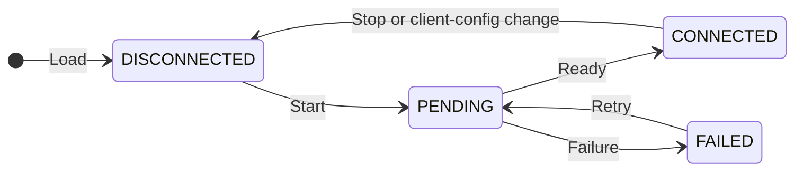
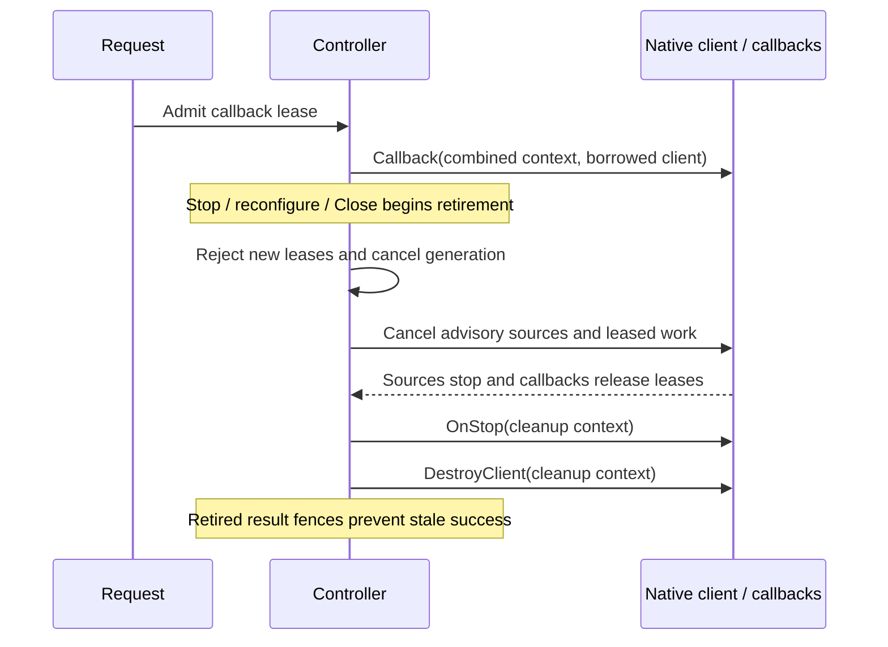

# Manage native connections

**API status:** implementation candidate, not an approved public contract. This page describes current source behavior.

[Documentation home](README.md) · [Quickstart](quickstart.md) · [Resource tasks](resources.md) · [API reference](resource-v2-api.md) · [Migration](sdk-v1-v2-overview.md)

Use this guide when your plugin needs configured profiles and native clients. For immutable embedded data, keep the [quickstart's lifecycle-free controller](quickstart.md).

## Outcomes

1. Choose who owns native client lifetime.
2. Load configured profiles without starting clients.
3. Start one explicit connection and lease its client.
4. Retire clients without leaking work or publishing stale results.

Prerequisites: a route-qualified catalog and an operation implementation. See [resource tasks](resources.md).

## Choose client ownership

| Your source | Setup | Callback client |
| --- | --- | --- |
| Embedded data or client-free operations | `Config[struct{}]` with nil `Lifecycle` | Nil; valid for finite dispatch |
| Configured native SDK clients | `Config[T]` with `Lifecycle[T]` | Borrowed `*T` from an explicitly started generation |
| Custom lifetime/admission implementation | Implement `Provider` and optional interfaces directly | Your ownership; controller fences are not supplied |

No lifecycle does not mean no route. Catalogs and finite requests still carry an explicit route, such as the notes example's logical `local` route.

Do not add a second registry for utilities. Bind exec, logs, metrics, and forwarding to the shared configured-client registry through `ConnectionContextConsumer`. See [SDK capabilities](capabilities.md).

## Share connection access

An owner may declare `exports.connections` with `operations` and `resource_types`. A consumer may declare `requires.connections` entries with `plugin`, `operations`, and `resource_types`. Use `catalog`, `get`, `enumerate`, or `update` for operations. A resource type is a literal token or a nonempty literal prefix ending in `/*`. Wildcards match a nonempty suffix and are case-sensitive.

Call `PluginMeta.Validate` on each manifest, then `config.GrantConnections(consumer, owner)` to require complete coverage. `ConnectionGrant.Allows` checks an individual operation and literal resource type. Catalog access permits discovery, target resolution, and schema documents for permitted types. It does not authorize reading or writing resource objects.

This is installation-level opt-in, not a sandbox or per-user approval. The host must enforce live policy, per-call capabilities, target identity, connection lifetime, and grants. The callback transports only resource requests and results. It does not share credentials, native clients, or connection profile data.

## Wire the controller and hooks

`pkg/resource/v2/provider_options.go` — contextual declarations from [source](../pkg/resource/v2/provider_options.go), with comments omitted. These types use that package's `context`, `types`, and resource declarations.

```go
type Config[ClientT any] struct {
	Catalog       func(context.Context, CatalogRequest) (Catalog, error)
	Registrations []Registration[ClientT]
	Lifecycle     *Lifecycle[ClientT]
	ConnectionMetadata func(context.Context, types.Connection, *ClientT) (ConnectionMetadataUpdate, error)
	ResolveRegistration func(context.Context, AccessRoute, string) (Registration[ClientT], error)
	DynamicUpdates bool
	ErrorClassifier ErrorClassifier
}

type Lifecycle[ClientT any] struct {
	LoadConnections func(context.Context) ([]types.Connection, error)
	CreateClient    func(context.Context, types.Connection) (*ClientT, error)
	DestroyClient   func(context.Context, *ClientT) error
	CheckConnection func(context.Context, types.Connection, *ClientT) (types.ConnectionStatus, error)
	OnStart         func(context.Context, types.Connection, *ClientT) error
	OnStop          func(context.Context, types.Connection, *ClientT) error
}
```

Pass the config to `NewController`. It requires `Catalog`. A nonnil lifecycle also requires `LoadConnections`, `CreateClient`, and `DestroyClient`.

| Hook | Implement this behavior |
| --- | --- |
| `LoadConnections` | Return configured profiles, not active-client discovery |
| `CreateClient` | Construct one native client using the supplied profile and generation context |
| `DestroyClient` | Release one returned client; SDK invokes it exactly once per nonnil returned client |
| `OnStart` | Optional setup that must finish before leases become usable |
| `OnStop` | Optional cleanup after advisory sources stop and leases drain |
| `CheckConnection` | Optional native health probe; return status for the requested profile |

Nil client plus nil error is invalid. A nonnil client returned with an error is still destroyed. A failed `OnStart` also triggers cleanup.

Keep hook configuration and nested registration scopes immutable after construction. Synchronize mutable state captured by callbacks.

## Load, start, and use one profile

The runnable [`ExampleLifecycle`](../pkg/resource/v2/example_test.go) uses an in-memory example client to demonstrate ownership, not a real network connection. Copy its control flow; replace its client hooks with your native implementation.

`pkg/resource/v2/example_test.go` — contextual excerpt inside `ExampleLifecycle`, after controller construction and `defer provider.Close()`. The setup in the linked source defines `provider` and `err`.

```go
ctx := context.Background()
if _, loadErr := provider.LoadConnections(ctx); loadErr != nil {
	panic(loadErr)
}
if _, startErr := provider.StartConnection(ctx, "profile"); startErr != nil {
	panic(startErr)
}
err = provider.WithConnection(
	ctx,
	resourcev2.AccessRoute{Connection: "profile"},
	func(_ context.Context, profile types.Connection) error {
		fmt.Println(profile.ID)
		return nil
	},
)
if err != nil {
	panic(err)
}
if _, err := provider.StopConnection(ctx, "profile"); err != nil {
	panic(err)
}
```

Expected printed checkpoint:

```text
profile
```

The callback receives the actual configured profile snapshot, not selector metadata. Use `Controller.WithClient` when provider-specific work needs the native client itself. Registered finite callbacks already run under client leases.

Neither helper starts a connection, probes health, selects a default, or authorizes resource access. `WithConnection` requires a configured, started generation and is unsupported without lifecycle. `WithClient` supplies nil without lifecycle.

### Inspect readiness separately from health

| Call | Result | Does not… |
| --- | --- | --- |
| `LoadConnections` / `GetConnection` | Configured profile snapshots | Start a client |
| `StartConnection` | Join or create startup for one configured ID | Select the first active profile |
| `GetConnectionStatus` | Registered lifecycle readiness immediately | Wait, start, lease, or probe the network |
| `CheckConnection` | Optional native health check; local lifecycle status when hook is nil | Make `CONNECTED` a network-health guarantee |
| `StopConnection` | Retire one generation | Remove its configured profile |
| `Close` | Cancel and retire provider-owned lifetime state | Substitute for per-request cancellation |

Unknown profile IDs return `NOT_FOUND`. Lifecycle methods are unsupported when no lifecycle is configured.

## Publish connection/server facts

Set `Config.ConnectionMetadata` to negotiate the optional `connectionMetadata` trait. The callback receives the configured profile and an already-started, lease-bound client. It must return public server/service observations, not modify `Connection.Data` or return resource inventory.

Inside the callback, after acquiring `version` and its UTC `observedAt`, construct an update:

```go
return resourcev2.ConnectionMetadataUpdate{
	Set: map[string]resourcev2.ConnectionMetadataObservation{
		"kubernetes.server_version": {
			State:      "success",
			Value:      version,
			ObservedAt: observedAt,
		},
	},
}, nil
```

Use namespaced keys such as `aws.region` and `kubernetes.server_version`. Dots are literal map-key characters. Keep each key's meaning and JSON type stable; use a new key for incompatible changes. Unknown keys remain extensible without a registry.

| Provider result | SDK behavior |
| --- | --- |
| Successful key in `Set` | Store its value and observation timestamp as current |
| Unavailable key in `Set` | Keep its previous value stale, or report unavailable if none exists |
| Key in `Remove` | Delete it |
| Omitted key | Preserve its value and freshness |
| Overall callback error | Mark retained values stale and expose a safe refresh error |

An attempted key must produce success or unavailable. An update is atomic; overlapping set/remove keys and invalid or oversized JSON reject the result. Explicit null, false, zero, and empty string remain values. Use strings for large integers, IDs, and versions that cannot round-trip through JavaScript numbers.

Limits apply to encoded JSON, including native `float32` values: 16 KiB per entry and 256 KiB per snapshot. Admission and wire encoding enforce the same limits, so an accepted value remains readable across the plugin boundary.

`ConnectionMetadataProvider` exposes `GetConnectionMetadata`, `RefreshConnectionMetadata`, and `WatchConnectionMetadata`. Get never acquires. Refresh never starts a connection. Start schedules observation; concurrent refreshes coalesce. `InvalidateConnectionMetadata` queues a serialized refresh when server discovery changes. Reuse cached facts only when cache updates share that acquisition ordering.

Stop revokes publication before cancellation and retains observations as stale. Reconnect creates a new generation; configuration changes and removal clear old facts. Revisions remain monotonic within the provider lifetime, including removal tombstones. Watch replays current snapshots/tombstones and returns `RESET_REQUIRED` when a slow consumer must resynchronize.

Current means generation-valid, not a recency guarantee. Metadata grants neither resource capabilities nor authorization. Never publish credentials, raw native errors, or resource counts. Sanitize endpoint userinfo, query strings, and fragments before returning values. Metadata remains in memory and never becomes desired profile configuration.


## Follow the state transitions

The main startup and retry path is below. Stop or Close can also interrupt startup; use the retirement sequence in the next section for cancellation and drain ordering. Retirement is not an additional public readiness status.



A failed start retains only safe `FAILED` status after cleanup, not its client or diagnostic error. Retry clears that marker and creates a fresh generation. Stop or meaningful configuration replacement clears it too; display-only edits preserve it.

`CONNECTED` means successful lifecycle registration. Network health may change independently.

## Respect lease and retirement ordering



Return borrowed clients before retirement can finish. Do not retain the client or lease context for unowned background work.

| Owner | Cancellation and concurrency rule |
| --- | --- |
| Startup creator | Its request cancellation cancels startup until construction finishes |
| Concurrent startup waiter | Its cancellation ends only its own wait, not shared startup |
| Controller | Owns an accepted generation after the start request completes |
| Request lease | Combines caller, controller, and generation cancellation |
| Provider callback | Observe cancellation; synchronize shared native client and captured state |
| Cleanup hook | Uses context without retired cancellation/deadline; must terminate without waiting for that cancellation |

Callbacks can overlap across requests, watches, connections, and discovery. A blocked callback can block retirement. Result fences reject retired results even when native code ignores cancellation; fences do not unblock native work.

Never synchronously stop, close, or reconfigure the generation whose lease your callback holds. Retirement waits for that lease. Teardown hooks must not synchronously reenter inventory mutation or refresh.

Connection snapshots are independent mutable copies at SDK boundaries. Editing a returned profile does not apply a configuration change. General finite inputs/results remain borrowed during SDK use; return stable, independently owned results.

See [full lock and ownership rules](resource-v2-contracts.md#concurrency-and-ownership).

## Apply configured-profile overlays

`ApplyConnectionOverlay` replaces the explicit desired in-memory overlay. The host owns persistence and startup replay; the SDK does not rewrite native configuration files.

| Overlay change | Effect |
| --- | --- |
| Upsert | Manual profile or override; native refresh cannot erase it |
| Disabled ID | Tombstone; native refresh cannot resurrect it |
| Empty overlay | Restore native configuration |
| Display-only edit | Preserve active client generation |
| ID, UID, public data, or private client-config change | Retire affected generation before publishing effective inventory |

Inventory changes stage affected routes, block new starts, cancel/drain old generations, then publish effective inventory together. Failed teardown or canceled application keeps previous desired inventory, but already retired clients stay retired.

Reapplying an earlier profile never resurrects old clients or epochs. Do not persist native private credentials. See [overlay inheritance and failure rules](resource-v2-contracts.md#connection-lifecycle-and-overlays).

## Bind utilities without inventing resources

A connection lease selects native access. It does not grant canonical resource permission.

| Utility input | Required admission |
| --- | --- |
| Canonical resource reference | Selected configured connection, exact route, accepted catalog observation; host authorization remains separate |
| Explicit route without reference | Matching selected configured connection; no fabricated reference or pin |
| Opaque nonreference selector or cluster metric | No fabricated resource or catalog pin; selected connections still use registry admission |
| No selected connection, reference, or route | `WithUtilityConnection` may call directly without registry admission |

Resource-bearing data is not automatically reference-bearing intent. `WithUtilityConnection` does not perform an unrelated Get. Body validation alone does not establish connection admission.

### Check accepted-session lifetime

| Utility | Lifetime boundary |
| --- | --- |
| Resource forwarding | Retains configured-generation lease through accepted session close, native completion, or retirement |
| Logs | Creates `connecting` session before asynchronous native readiness; admission lease does not cover that acquisition |
| Exec | Session engine owns accepted-session close and RPC-independent lifetime; do not assume forwarding's retained lease |
| Metrics | Request/stream cancellation and owner-scoped subscriptions remain attached |

**Logs require explicit integration cleanup.** Connection retirement alone does not cancel or await asynchronous log acquisition. Close affected log sessions when retiring a connection, or shut down the log manager. Returning a session is not proof of native readiness. Stronger generation ownership remains a pending contract decision.

For stream readiness and utility-specific details, use [advanced lifetime contracts](resource-v2-contracts.md#utility-and-stream-lifetime).

## Next steps

- [Declare capabilities and add handlers](resources.md).
- [Look up requests, results, and errors](resource-v2-api.md).
- [Register other SDK capabilities](capabilities.md).
- [Migrate lifecycle and utility callers](sdk-v1-v2-overview.md).
