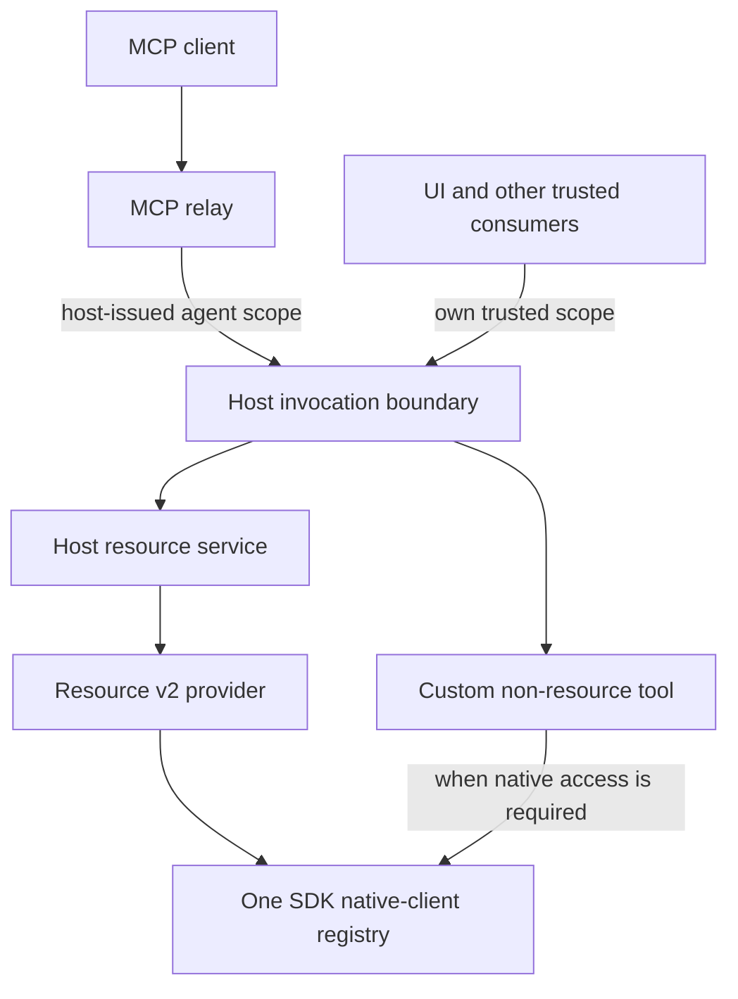

# MCP integration with resource v2

**Status: landing plan, not implementation or API acceptance.**

The MCP relay should consume the same host resource services as the UI. Plugins should not implement a second resource engine for agents. Custom SDK tools remain an extension lane for non-resource work.

This catalog follows [Alex Mononen’s PR21 comment][alex], [SDK issue25][sdk-issue], [host issue219][host-issue], and [Kubernetes issue62][kube-issue]. Eight parallel domain audits inspected their implementation evidence and the relay review.

**Coverage:** 33 issue sections/feature rows, 16 inline review findings, and three additional review notes. These are **52 source items**, not 52 independent defects. Overlapping reports share work packages below.

> [!IMPORTANT]
> Resource SDK API acceptance remains pending. This plan does not authorize merging, marking the SDK ready, freezing its API, tagging, releasing, or changing managed module replacements.

## Read this plan

| Task | Section |
| --- | --- |
| Understand the intended integration | [Target flow](#target-flow) |
| Assign implementation ownership | [Work packages](#work-packages) |
| Find decisions that need approval | [Contract decisions](#contract-decisions) |
| Trace every original finding | [Source checklist](#source-checklist) |
| Separate later AI work from landing | [Roadmap disposition](#roadmap-disposition) |
| Plan execution and verification | [Landing order and evidence](#landing-order-and-evidence) |

## Target flow

**Proposed integration, not the current relay path:**

The invocation boundary owns authorization. A catalog declaration describes support; a revision records an observation; a confirmation records consent. None substitutes for the others.

A client-free provider does not need a native client. A plugin-scoped custom tool does not need a fabricated connection or resource catalog.

### What the audits corrected

- `Host` is invocation provenance, not an implemented privilege ranking. The problem is agent calls using host provenance and bypassing admission; the current resource boundary is composed without an authorizer.
- Readiness is not a lease or network-health probe. Require registered-generation admission for native work, not universal Kubernetes-style `CONNECTED` checks.
- Full custom-tool names already receive a host length/character check. Built-in names and reserved-argument collisions remain gaps.
- `Dangerous:false` does not prove read-only, non-destructive, or idempotent behavior. MCP annotations are hints, not authorization.
- Catalog CRUD does not replace label filtering or bounded logs. Existing `get_pod_logs` advertises a first-container default that its handler does not implement.
- Kubernetes resource error producers put native diagnostics in public fields. **Normal resource gRPC already strips that text.** Legacy tool errors leak directly; asynchronous logs error events need separate safe handling before MCP consumption.
- P01’s numeric contract/design-spike handoff was accepted. Older numeric holds are historical; that acceptance does not establish an installed universal query service or approve the SDK API.

## Work packages

Ownership below names repository roles, not assigned people. Source writers must own nonoverlapping files. The shared host integration owner serializes changes to `main.go`, `internal/mcprelay/server.go`, controller composition, and generated consumers.

### W1 — Agent admission, consent, and readiness

**Owner:** host invocation/security. **Files:** `backend/pkg/invocation`, relay policy/confirmation, admitted connection inventory, composition.

**Evidence:** [invocation origins and admission][invocation]; relay `server.go:300–315,398–469`; v2 `backend/pkg/plugin/resource/invocation.go:15–57`. Current production composition uses `NewBoundary(nil)` at host `main.go:293–295`.

- Issue host-owned external-agent provenance after bearer authentication. Never trust MCP client names, requester strings, tool arguments, or connection IDs as identity.
- Configure one authorizer. Treat persisted relay policy as input to that boundary, not an independent permission grant. Preserve native settings-management access separately from agent-visible inventory.
- Admit the actual resource operation/target. For custom tools, use the real boundary shape: `Target.Provider`, `Target.Action`, and a separate operation argument—not the issue’s illustrative nonexistent fields.
- Filter broad inventory per permitted member. Return readiness truthfully; never implicitly start or select a connection.
- Bind confirmation to immutable arguments, caller owner, route/reference/action, catalog observation, relevant generations, and supported write preconditions.
- Recheck authorization and target validity after approval, immediately before dispatch. Define policy-update/dispatch ordering; another unlocked config snapshot alone is not a complete race contract.
- Retire pending consent and accepted work across relevant plugin, route, listener, and credential changes. Consent never transfers silently to a replacement implementation.
- Record correlated admission, consent, dispatch, and outcome evidence with deliberate argument/token redaction.

**Accept when:** denial wins even after approval; policy revocation while a prompt waits causes zero provider calls; stop/reconfigure between discovery and dispatch fails closed; client-free tools remain usable without invented native readiness.

### W2 — SDK custom-tool routes and native ownership

**Owner:** SDK tools/runtime. **Files:** `pkg/v1/tools`, `pkg/sdk/plugin.go`, `proto/v1/tools/tools.proto`, affected consumers and docs.

**Evidence:** [existing capability binding][sdk-binding]; tools `plugin.go:23–32`, `manager.go:80–99`; resource `utility_context.go:36–96` and `controller_lifecycle.go:31–82`.

- Tools currently participate in neither transport-level connection-consumer forwarding nor manager-side utility admission. Adding only the forwarding method does not fix dispatch.
- Specify explicit connection-route semantics, then migrate request types, transport, callers, and documentation together. Reject empty routes and conflicting selectors before handlers run.
- Replace caller-supplied connection data with the sole configured registry snapshot. Use the existing controller’s typed `WithClient` within the accepted callback context; a `ConnectionContextProvider` does not itself return a typed native client.
- Preserve cancellation, retirement drain, and post-dispatch result fences. Nested native access must retain the same slot rather than switch to a replacement generation.
- Keep three observations distinct: **plugin process generation**, **native-client generation**, and **resource catalog revision**. `CatalogBindingEpoch` is not all three.
- Fence custom dispatch against plugin replacement even when no native client exists. Opaque custom tools need no fabricated resource pins.
- Decide whether route-dependent custom tools need their own discovery observation. A general dynamic-tools subscription RPC is not required merely to expose resource CRDs through the host catalog.
- Preserve connection-free plugin tools, caller cancellation, and supported result contracts. Regenerate protobuf with `make proto` after an accepted wire change; never hand-edit generated Go.

**Accept when:** forged profile data cannot select credentials; unstarted native routes never run handlers; retirement cancels work and discards late success; either capability-registration order produces actual admitted native behavior; plugin-only tools work without a resource provider.

### W3 — Schemas, annotations, errors, and exact arguments

**Owner:** SDK protocol and host conversion. **Files:** tools types/protobuf/client/server, resource ancillary schemas, relay `catalog.go`, validation/error mapping.

**Evidence:** [SDK tool validation][tool-validation]; [resource error wire policy][wire-errors]; relay `catalog.go:99–166`, `server.go:370–482`; [MCP 2025-11-25 tools specification][mcp-tools].

- Validate complete input/output schema declarations before publication. Validate inputs before native work and structured outputs against any declared output schema.
- Preserve the existing restricted action schema honestly. It cannot recover absent `items`, unions, arbitrary enums, or other missing assertions. Do not silently drop constraints or invalid output schemas.
- Decide supported dialects, reference resolution, and `format` policy. Do not fetch external schema references automatically. Do not apply defaults or coerce input values during validation.
- Reject malformed/duplicate JSON independently from schema assertions. Preserve raw-wire/domain validation and protobuf presence distinctions for any accepted new fields.
- Preserve remaining argument tokens when extracting `connection_id`. The relay currently decodes through `map[string]any` and re-marshals, which can alter large integers.
- Reserve injected arguments before mutation; validate the final exposed schema. Check built-in and custom names and report collisions explicitly. MCP itself does not reserve `connection_id`.
- Preserve annotation absence versus explicit false. MCP defaults are read-only=false, destructive=true, idempotent=false, open-world=true. Choose the Go/wire presence shape explicitly; do not infer safety from `Dangerous:false`.
- Carry reviewed custom-tool error classifications with safe host presentation. Keep raw diagnostics local. Distinguish protocol failures, transport failure, cancellation/deadline, and successful RPCs carrying tool execution errors.
- Preserve existing resource gRPC sanitization. A typed error structure alone does not sanitize arbitrary text fields or asynchronous log events.

**Accept when:** malformed nested schemas and duplicate required names cannot publish; invalid inputs cause zero handler calls; declared output mismatches never escape as success; omitted/explicit-false annotations survive transport; secret-bearing failures stay out of model-visible text and structured fields.

### W4 — Catalog-derived resource tools and result contracts

**Owner:** host resource/MCP integration. **Files:** relay catalog/handlers/results, resource finite/reference/ancillary admission, logs consumer.

**Evidence:** [typed host resource service][host-service]; [catalog admission][host-finite]; relay `server.go:318–365`; resource v2 `domain.go:268–335`.

| Existing Kubernetes tool | Host path | Required replacement behavior |
| --- | --- | --- |
| `get_resource` | `ResolveReference` → `Get` | Exact route/reference/representation; scoped Get capability; intentional body projection. |
| `list_resources` | `ResolveTarget` → `Enumerate`, or an accepted host query path | Explicit source-page semantics, selectors, scope, finite budgets, continuations, coverage. |
| `delete_resource` | Resolve exact reference → `Mutate` with delete | Independent delete capability, consent/admission, incarnation and supported revision preconditions. |
| `list_namespaces` | Negotiated `ScopeValues(route, "namespace")` | Kubernetes adapter behavior, not a namespace requirement in generic SDK. |
| `get_pod_logs` | Admitted logs session → bounded headless consumption → close | Finite non-following output, cancellation, aggregate cap, safe errors, lifecycle ownership. |

- Generate only supported, admitted operations. Get/enumerate, create, mutation-update, delete, advisory update, and actions are independent.
- Retain each advertisement’s route/catalog/plugin observation through dispatch. Current host catalog admission reacquires a catalog and installs a fresh default pin; merely passing an old pin does not preserve advertisement semantics.
- Bind continuations to their original target, route, representation, and source generation. Never silently repin a stale tool or cursor.
- Treat plugin/type/action IDs as opaque. Choose bounded collision-safe names; separate resource operations from action IDs. Punctuation normalization is not identity encoding.
- Define route-specific schemas without leaking one connection’s catalog into another. Replace same-name descriptors and handlers, not only names.
- Preserve tagged `Value` kinds in resource inputs/results: signed/unsigned decimal strings, finite doubles including negative zero, nanosecond timestamps, null, and empty containers. Raw JSON bytes alone do not prove consumer fidelity.
- Specify a host-owned resource result envelope: reference, route, representation, record/page source revisions, coverage, count kind/value, cursor, consistency, and explicit output truncation. Keep these revisions distinct from incarnation and host row keys.
- Reauthorize cited resources on later graph/history traversal. Basic provenance is needed now; a full history adapter is not implied.
- Advertise actions only with a faithful schema and supported dispatch lane. Type-scoped actions currently lack a type-only request shape; never fabricate an object ID. Streaming actions must not call unary dispatch.
- Add bounded headless logs consumption through existing sessions, not a second logs engine. Resolve SDK issue23’s relevant lifetime decision before claiming retirement-safe parity.

**Accept when:** two routes with different catalogs cannot borrow capabilities; stale advertisements fail rather than refresh silently; delete-only support exposes no other writes; exact scalar kinds survive a real MCP client; incomplete pages stay incomplete; finite logs close on completion, cancellation, errors, and limits.

### W5 — Kubernetes clean cutover and parity

**Owner:** Kubernetes adapter. **Files:** `pkg/main.go`, `pkg/plugin/tools`, resource catalog/read/mutation/error adapters, logs, `plugin.yaml`.

**Evidence:** [merged five-tool implementation][kube-tools]; v2 `native_read.go:68–108`, `native_mutation.go:18–63`, `native_catalog.go:26–134`; [error producer][kube-errors].

- Preserve metrics-first registration: `retireMetrics := pluginmetric.Register(plugin)` followed by `resource.Register(plugin, retireMetrics)`. Keep the host’s metric pre-change fencing hook.
- Do not add a tools-owned client cache. Existing resource tools construct a complete Kubernetes client stack per call, outside the shared registry.
- Preserve meaningful behavior before removing all five tools: label selectors, explicit namespace rules, served API-version handling, managed-field projection, pagination, bounds, and bounded pod logs.
- Existing omitted list namespace means all namespaces; Get/delete require namespace for namespaced kinds. Neither may widen configured or authorized scope.
- Existing list cap is 500; v2 source pages cap at 256 and currently do not forward label selectors. Aggregate through bounded accepted semantics or get an explicit scope decision; do not silently drop filters or raise provider ceilings.
- Existing logs default tail is 200, clamp at 5,000 lines, and cap output at 1 MiB. Empty container is delegated to Kubernetes despite descriptor wording. Define selection and timestamp differences explicitly.
- Sanitize resource producer public fields while retaining native causes in `Err`. Also sanitize asynchronous log error events before exposing them to MCP; ordinary resource-wire sanitization already exists.
- A connection-qualified startup catalog is not proof of live CRD watching. Define refresh triggers and emitted tool-list changes honestly.
- After replacement acceptance, delete the obsolete tools implementation/tests, import/registration, and manifest capability. Keep shared utilities still used by other lanes. No empty registration shims.

**Accept when:** all five replacements preserve agreed observable behavior; stale UID/revision cannot delete a replacement object; native work uses admitted generations; per-cluster CRDs differ truthfully; metrics and utility cleanup still retire correctly. None of the existing five tools requires permanent custom-tool retention.

### W6 — Relay/controller lifecycle and persistence

**Owner:** host tools/lifecycle. **Files:** tools controller, plugin loader rollback, relay listener/resync, connection inventory publishers, existing store integration tests.

**Evidence:** relay tools `controller.go:105–169,203–235`; relay `server.go:188–255,318–365`; v2 connection publication and metric hook; inline findings in the source checklist.

- Bound startup discovery and cancel it with its owner generation. Reject late completion; clear stale providers/descriptors on replacement failure and roll back partial startup if another capability later fails.
- Fence captured calls and results across plugin replacement. Deleting a cache entry is not cancellation or a result fence.
- Bound authenticated POST body bytes and body-read time, including chunked bodies. Clear body-specific deadlines after reading; do not truncate SSE or two-minute confirmation with a blanket write/request timeout.
- Serialize whole listener transitions. Stop accepting, cancel pending work, bound session drain and HTTP shutdown, and close remaining connections after the chosen grace period.
- Serialize complete resync before snapshot through MCP publication. Replace same-name definitions using supported replacement behavior. Do not claim that a resync mutex makes all tool registrations an atomic batch.
- Publish committed connection inventory changes after relevant locks release. Cover discovery, explicit profile mutations, load/replacement/removal, and unload. The metric hook is **pre-change fencing**, not a replacement post-commit notification.
- Own subscription cleanup; stopped services must not republish from late callbacks. Emit MCP list-change notifications after effective publication, not only UI events.
- Resolve the `Listed` mismatch deliberately. Current global enablement can advertise without an accessible connection, but dispatch still rejects disallowed connections; this is not a proven authorization bypass.
- Exercise real bbolt close/reopen with nested policies and nil/explicit-false overrides. Place the integration test where it does not create a store↔relay import cycle.

**Accept when:** hanging discovery/shutdown stays bounded; failed replacement leaves no callable stale tools; concurrent edits publish latest state; old tokens/listeners retire; inventory changes refresh without unrelated settings edits; nested effective policy survives reopen.

### W7 — Author-facing settings and confirmation UI

**Owner:** host UI/runtime bindings. **Files:** MCP hook, settings page/router, confirmation provider, app/window composition, generated runtime consumers.

**Evidence:** relay `ui/App.tsx:103–109`, MCP hook `:28–68`, confirmation provider `:34–74`; seven inline UI comments and one review note below.

- Make consent reachable with only a panel window visible; choose window ownership rather than assume a hidden workspace is usable.
- Prevent stale status queries from overwriting newer events. Invalidate connection queries from the same committed inventory signal used by relay discovery.
- Distinguish failed status/config/inventory/tools queries from stopped, empty, or absent states. Do not enable configuration writes from a failed authoritative config load.
- Prevent delayed initial pending snapshots from restoring resolved requests. Preserve actionable requests after failed decision submission; expose pending-list load failure and explicit recovery.
- Reject unsupported AI Tools focus-target navigation without breaking normal navigation.
- Show real route-scoped tool rows, independent capabilities, readiness, effective inherited policy, and hint-versus-authorization distinctions.
- Display trustworthy origin/owner, exact target, and meaningful arguments for consent. A client-supplied display name is not authenticated identity.
- Preserve nullable override inheritance and exact values. Regenerate changed bindings through normal generators; no current binding mismatch was demonstrated.

**Accept when:** delayed query/event order stays truthful; failed Allow/Deny can recover; resolved/expired requests never resurrect; two scopes render different real rows; panel-only users can approve/deny; fetch failures never masquerade as an empty catalog.

### W8 — Composition, cohort, release policy, and roadmap ledger

**Owner:** one cross-repository integration owner and one CI/release-policy owner.

- Keep both host insertions: `resourceController.SetConnectionChangeHook(metricController.BeginConnectionChange)` and tools controller construction. Preserve resource-v2 and tools loader registration.
- Reconcile Kubernetes registration as W5 describes. Report historical conflict receipts as historical. Issue62’s prose baseline and command output disagree; no fresh conflict count is claimed here.
- Record both committed dependencies and effective managed replacements. Relay requires SDK `v0.8.0`/Go `1.26.0`; committed host-v2 and Kubernetes-v2 require SDK `v0.7.1`/Go `1.25.0`. Existing tags do not constitute resource-v2 acceptance.
- Decide CI trust policy explicitly. [Alex’s release-gate explanation][ci-comment] says PR218 gives up the separately reviewed isolation-core baseline in CI, replacing it with release-tag publisher trust. That is not merely a version bump.
- Reconcile resolver, both workflows, reviewed candidate path, source cohort, Kubernetes gitlink, cache fixtures, and toolchain as one reviewable integration. Candidate testing must not force publication of an unaccepted SDK.
- Only after explicit future API acceptance and release authorization: select publication versions, publish compatible artifacts, and update downstream modules/checksums/cohort. This plan selects no next tag.
- Name the relay as a consumer of existing resource/invocation seams in the roadmap. Do not retroactively mark query, history, diagnostics, or autonomous writes implemented.
- Link later P01 acceptance where historical holds remain. Do not reopen accepted foundation decisions or require an upstream CLA/PR that later acceptance made optional.

**Accept when:** an explicitly authorized candidate cohort can be tested without misleading release claims; release validation resolves the authorized published SDK and exact plugin cohort; isolation-core trust has an explicit approval record; managed workspaces retain their replacements.

## Contract decisions

These are **UNACCEPTED integration proposals**, not silent changes to the SDK contract.

| Decision | Resolve before exposing the affected behavior |
| --- | --- |
| D1 — Caller ownership | Shared credential versus per-session/per-client principal; confirmation ownership; token/session retirement. |
| D2 — Custom tool routes | Body route, metadata conflict/missing-context rules, plugin scope, registry-free tools, and native-only tools without a resource capability. |
| D3 — Observations and refresh | Retained resource advertisement pins; custom discovery tokens only where needed; per-route schema variants; refresh signals and publication ordering. |
| D4 — Schema policy | Honest restricted action projection versus expanded schema API; dialect/ref/format policy; absent-schema behavior; input/output validation. |
| D5 — Safety and consent | Annotation presence/defaults; trusted operation classification; consent recheck ordering; required agent-write preconditions and audit redaction. |
| D6 — List parity | Source page versus host query, selector lowering, explicit API versions, projection/coverage, overall limits, and opaque names. |
| D7 — Results | Tagged resource envelope and citations versus unchanged custom JSON results; truncation/count/cursor semantics. |
| D8 — Actions and logs | Type-only action target contract; streaming handle owner/cancel rules; finite logs selection/budgets; issue23 session-generation ownership. |
| D9 — Discovery readiness | Usable-only versus status-bearing unavailable routes; unsupported readiness for native work; `Listed` zero-connection behavior. |
| D10 — CI trust and publication | Independent reviewed isolation baseline versus tag-derived trust; approved candidate path; later publication authorization. |
| D11 — Confirmation windows | Visible workspace activation versus eligible panel ownership; truthful principal/target display. |

Do not automatically retry writes after retirement, timeout, or post-dispatch rejection. A rejected result is not proof that a native side effect rolled back.

## Source checklist

**Open** means work remains at the inspected revision. **Decision** means the source asks for behavior whose contract needs approval. **Covered** means no duplicate feature is needed. **Roadmap** remains cataloged but is not automatically a safe-unary/five-tool landing gate. **Historical/conditional** is not a fresh check or release authorization.

### SDK issue25

| Source item | Disposition | Work |
| --- | --- | --- |
| SDK-A1 — existing tools inheritance | Preserved; not v2-integration proof. | W2, W8 |
| SDK-A2 — release/module pins | Conditional on future acceptance and authorization. | W8 |
| SDK-B1 — connection selection | Open; explicit route and shared native lease. | W1, W2 |
| SDK-B2 — action/tool vocabulary and schemas | Decision; scopes differ, safety is not boolean equivalence. | W3, D4–D5 |
| SDK-B3 — errors | Open; classified public-safe custom failures. | W3 |
| SDK-B4 — catalog/generation fences | Open; separate process/native generations from catalog observations. | W2, W4 |
| SDK-B5 — static discovery | Open for resource refresh; general custom subscription is a decision. | W2, W4, W6 |
| SDK-B6 — duplicate resource tools | Open; host service dispatch, not plugin resource reimplementation. | W4, W5 |
| SDK-C01 — typed filters | Roadmap; schema structure and query support are distinct. | Roadmap/P07/P13 |
| SDK-C02 — resource description | Optional enrichment; precedence/bounds undecided. | Roadmap |
| SDK-C03 — per-type capabilities | Covered; consume scoped independent operations. | W4 |
| SDK-C04 — action schemas/danger | Decision; never discard unavailable assertions. | W3, D4–D5 |
| SDK-C05 — scale hints | Roadmap; hints never override finite budgets. | Roadmap |
| SDK-C06 — headless search | Roadmap; host-owned, not a React callback or separate engine. | Roadmap |
| SDK-C07 — streaming/progress | Decision/later adapter; unary custom transport does not implement it. | D8, Roadmap |
| SDK-C08 — list-change notification | Open for advertised route/resource changes. | W4, W6 |
| SDK-C09 — provenance/citations | Basic resource envelope required; history adapter later. | W4 |
| SDK-C10 — lossless numbers | Open; exact resource envelope and unaltered custom arguments. | W3, W4 |
| SDK-C11 — argument validation | Open; declarations, inputs, and declared outputs. | W3 |
| SDK-C12 — annotation defaults | Open; absence/false distinction; hints are not grants. | W3 |
| SDK-C13 — reserved arguments/name length | Partial correction: custom combined-name check exists; built-ins/injection remain. | W3, W4 |

Source: [full SDK audit][sdk-issue]. C numbers follow its feature-table row order.

### Host issue219 and Kubernetes issue62

| Source item | Disposition | Work |
| --- | --- | --- |
| HOST-A — composition conflict/cohort | Historical overlap; keep both hooks and reconcile gate. | W8 |
| HOST-B1 — invocation boundary | Open; host-issued agent origin, one authorizer, fresh consent. | W1 |
| HOST-B2 — readiness | Open for native work; not a universal lifecycle requirement. | W1, D9 |
| HOST-B3 — generated resource tools | Open; five-tool parity and correct admitted dispatch. | W4, W5 |
| HOST-B4 — errors/refresh | Open; safe errors, retained observations, replacement. | W3, W4, W6 |
| HOST-B5 — roadmap ledger | Open; separate relay consumer from deferred engines. | W8 |
| HOST-C — relay-local review | All inline findings and extra notes enumerated below. | W3, W6, W7 |
| K8S-A — registration conflict/pin | Historical overlap plus conditional publication dependency. | W5, W8 |
| K8S-B1 — per-call clients | Open; remove unmanaged resource-tool path after replacement. | W2, W4, W5 |
| K8S-B2 — duplicated operations | Open; selector/projection/version/log parity precedes deletion. | W4, W5 |
| K8S-B3 — native error text | Legacy leak open; resource producer violation is wire-mitigated; logs events separate. | W3, W5 |
| K8S-B4 — static list | Open; route catalogs and honest refresh, not assumed CRD watching. | W4, W5, W6 |

Sources: [host audit][host-issue], [Kubernetes audit][kube-issue].

### Relay PR218: all 16 inline findings

All remain actionable at the inspected relay head; CR-02 needs a contract decision rather than an assumed security fix.

| Source item | Required result | Work |
| --- | --- | --- |
| [CR-01][cr01] — discovery timeout | Bound startup RPC and generation-owned cancellation. | W6 |
| [CR-02][cr02] — `Listed` mismatch | Choose zero-accessible-connection discovery behavior; no proven dispatch bypass. | W6, D9 |
| [CR-03][cr03] — POST body limits | Bound bytes and read duration without breaking streams. | W6 |
| [CR-04][cr04] — post-confirm policy | Reauthorize current policy and unchanged target before dispatch. | W1 |
| [CR-05][cr05] — resync ordering | Serialize snapshot through final publication. | W6 |
| [CR-06][cr06] — panel confirmation | Make consent visible when workspace is hidden. | W7 |
| [CR-07][cr07] — status event race | Newer event survives delayed status response. | W7 |
| [CR-08][cr08] — tools query errors | Show failure, not successful empty catalog. | W7 |
| [CR-09][cr09] — resolved request resurrection | Delayed initial snapshot cannot restore resolved consent. | W7 |
| [CR-10][cr10] — failed replacement cache | Remove failed generation and roll back partial startup. | W6 |
| [CR-11][cr11] — schema keyword validation | Reject malformed declarations before advertisement/injection. | W3 |
| [CR-12][cr12] — same-name replacement | Replace descriptor, captured handler, and provenance. | W4, W6 |
| [CR-13][cr13] — backend inventory change | Publish committed changes; refresh advertised tools. | W6 |
| [CR-14][cr14] — UI inventory change | Invalidate mounted settings inventory from same signal. | W7 |
| [CR-15][cr15] — AI Tools focus target | Reject unsupported alias focus while preserving valid navigation. | W7 |
| [CR-16][cr16] — failed consent submission | Keep request actionable until success or authoritative resolution. | W7 |

### Relay review: three additional notes

These are [review5706913275 notes][relay-review], not extra inline comments or proven production defects.

| Source item | Disposition | Work |
| --- | --- | --- |
| NOTE-01 — built-in/plugin `list_connections` collision | Existing precedence works; missing meaningful collision regression. | W3, W6 |
| NOTE-02 — real nested bbolt round trip | Evidence gap, not demonstrated storage corruption; preserve nullable overrides. | W6 |
| NOTE-03 — scoped settings rows | Existing test returns same tools for every scope; assert distinct visible rows. | W7 |

### Additional findings beyond the original checklist

| Finding | Required action | Work |
| --- | --- | --- |
| N1 — fresh host catalog pin can erase stale advertisement | Compare retained observation before normal dispatch pin installation. | W4 |
| N2 — later capability startup failure can retain tools | Roll back tools when whole plugin startup fails. | W6 |
| N3 — listener transitions/session drain are not fully bounded | Serialize transition; cancel/drain/close under one owned lifetime. | W6 |
| N4 — status/config/inventory errors masquerade as state | Explicit failure states; no writes from failed config load. | W7 |
| N5 — pending snapshot failure lacks recovery | Show failure and provide explicit reload/retry. | W7 |
| N6 — replacement-path public errors are not uniformly safe | Preserve resource-wire mitigation; repair producer fields and handle log events safely. | W3, W5 |
| N7 — argument extraction changes numeric values | Preserve custom JSON tokens and canonical resource scalar kinds. | W3, W4 |
| N8 — CI change alters isolation trust | Obtain explicit approval; keep candidate verification distinct from publication. | W8 |
| N9 — type-scoped action/request mismatch | Do not invent object identities to expose type-only actions. | W4, D8 |
| N10 — CRD discovery is not an automatic watcher | Define refresh trigger before promising live tool-list changes. | W4, W5 |

## Roadmap disposition

The original [plans13–19][plans] contain useful intent and historical APIs. They are not the current resource-v2 contract.

| Source | Keep for this integration | Separate work; do not claim implemented |
| --- | --- | --- |
| Plan13 — query/filter introspection | Truthful schema/capability discovery; explicit unsupported results. | Typed query-field/operator metadata, optional descriptions/scale hints; P07/P13 ownership. |
| Plan14 — MCP runtime | Host resource path, explicit routes, admission, readiness, safe errors, cancellation. | Broader transports, subscriptions, progress/polling. Replace namespace/GVK-centric and unlimited-name assumptions. |
| Plan15 — query execution | Provider-native knowledge and bounded acquisition. | Historical `Find`/universal plugin predicates are not current APIs. No silent filter dropping or unbounded post-filtering. |
| Plan16 — natural-language translation | Metadata remains data; SDK never interprets prompts. | NL authoring over accepted host query contracts; not an agent-side authoritative query engine. |
| Plan17 — cross-provider routing | Preserve provider/route provenance and partial failures. | Global query/search/indexing and `QueryAll`; no mandatory watch-everything engine. |
| Plan18 — relationship graph | Canonical references, admitted targets, bounded traversal if exposed. | MCP graph adapters; existing graph seams do not prove integration. The [query-only-scope binding defect](resource-v2-contracts.md#relationship-helper-limitation) remains unresolved. |
| Plan19 — diagnostics | Honest health/event/relationship evidence if used. | Diagnose, trace-failure, blast-radius, common-cause products; shared dependency is not proof of root cause. |
| P01/P04/P13 | Accepted exact-value contracts; new agent invocation integration. | P01 acceptance is distinct from installed schema/planner/query receipts. Do not reopen its superseded numeric/CLA holds. |
| HR29 — read-only AI history | Permitted evidence citations and budgets inform results. | Headless history query/compare/traverse adapter; live resource reads are not a historical store. |

The [P01 acceptance record][p01-acceptance] supersedes earlier numeric holds. Confirm actual installed service receipts before advertising universal query/search tools. [SDK API review](resource-v2-spec-review.md) and [asynchronous logs issue23][logs-issue] remain separate gates.

## Landing order and evidence

1. **Review decisions:** resolve relevant D1–D11 choices and the SDK acceptance boundary. No publication action follows automatically.
2. **Safety wave:** W1/W2/W3 plus W6 startup/lifecycle hardening. Keep source writers package/file-owned; serialize shared files.
3. **Integration wave:** W4 resource tools/results and W6 coherent refresh. W7 can proceed on independent UI files once view/event contracts are agreed.
4. **Parity/cutover wave:** exercise all five replacements, then W5 deletes obsolete plugin tools. No silent feature loss or permanent compatibility shim.
5. **Cohort wave:** W8 reconciles composition, approved candidate CI, bindings, toolchain, and documentation. Future release pins require separate authorization.

### Evidence required from implementation

| Layer | Required proof |
| --- | --- |
| SDK | Focused native-generation/cancellation/retirement and wire-validation regressions; active lint, formatting, full normal and race suites. All Go/Make commands use `GOWORK=off GOFLAGS=`. |
| Host boundary | Real admitted agent requests, denial despite approval, policy/route/plugin retirement during consent, public-safe errors, actual audit correlation. |
| MCP transport | Actual authenticated MCP client: list/call/list-change, same-name replacement, invalid schemas/arguments, exact values, body bounds, and complete shutdown. |
| Resource parity | Point read, filtered multi-page list, scoped dimensions, delete with native UID/revision checks, two route-specific catalogs/CRD refresh. No extra Get permission merely to authorize logs/delete. |
| Logs | Real bounded one-shot stream: container/previous/tail, aggregate output cap, cancellation, close, safe async failures, issue23 retirement behavior. |
| UI | Actual visible multi-window approval plus meaningful delayed-response/error/scoped-row regressions; regenerated binding checks. |
| Integration | Separate reviewers per implementation slice and final cohort; central checks only after source writers finish. Keep formatting, behavior fixes, documentation, and structural changes reviewable separately. |

Passing SDK tests or old live-cluster receipts cannot establish the new MCP contract. Deferred `lint-audit` rules remain informational; do not turn them into extra acceptance gates.

### Evidence from this cataloging pass

- Retrieved all three primary issues: zero issue comments at capture; retained complete bodies.
- Retrieved all relay PR discussion, two reviews, and all 16 inline comments without replies; included the three embedded review notes.
- Verified 52 unique source-item IDs in an executable coverage inventory. Raw reports and domain evidence remain ignored under `.tools/mcp-audit/`.
- Eight domain agents performed read-only source audits. Two separate reviewers reconciled source coverage and integration contracts. Cross-domain review corrected producer-versus-wire error exposure, empty-container behavior, and superseded P01 holds.
- Rendered the Markdown and Mermaid locally in Chromium and exercised source-checklist navigation. This verifies documentation rendering, not MCP runtime behavior.
- No runtime code, generated code, managed replacement, lint policy, API acceptance, or release state changed. No new runtime/conformance pass is claimed by this document.

## Implementation wave 1 — API-preserving fixes

Two independent workers completed bounded fixes; separate reviewers checked each slice and the final integration. These changes do not accept D1–D11 or complete the broader work packages.

| Partial work package | Fix | Behavioral commit |
| --- | --- | --- |
| W3 — action descriptor validation | Reject duplicate `required` names in parameter/output schemas, including nested objects. Preserve nil/empty lists and required names absent from `properties`. | SDK [`6a7cecd`](https://github.com/omniviewdev/plugin-sdk/commit/6a7cecd) |
| W5 — Kubernetes error producers | Replace native API/network/certificate diagnostics in public fields with safe messages. Preserve classification, cause inspection, unknown-error fallback, and existing wire sanitization. | Kubernetes [`6d57348`](https://github.com/omniviewdev/omniview-plugin-kubernetes/commit/6d57348) |

Executed centrally after source writers finished; every Go/Make command used `GOWORK=off GOFLAGS=`:

| Check | Result |
| --- | --- |
| SDK focused `TestActionSchemaRequiredNames` | Passed; final regression covers 42 parameter/output, location, and required-list combinations. |
| Kubernetes focused `TestClassifyResourceError` | Passed, including hostile diagnostics and cause preservation. |
| SDK full normal and race suites | Both passed: 23 tested packages, 18 without tests. |
| Kubernetes full normal and race suites | Both passed: 11 tested packages, five without tests. |
| SDK `make fmt`, scoped `make fmt-check`, and active `make lint-report` | Passed; zero active findings. |
| SDK informational `make lint-audit` | 1,237 findings: paralleltest 585, protogetter 518, testpackage 82, nonamedreturns 29, funcorder 23. No policy changed. |
| SDK disposable consumer smoke | JSON round-trip rejected duplicate root/nested required lists in both schema roles and accepted unique undeclared names. |
| Kubernetes disposable native HTTP smoke | Actual client-go GET consumed a hostile 403 response; classifier retained `FORBIDDEN` and native cause while public JSON excluded diagnostics. |

Smoke source and the temporary private-classifier access hook were removed. No live cluster or MCP end-to-end pass is claimed. Full tool-schema validation, custom-tool errors, asynchronous logs, admission, discovery/generation integration, and the remaining catalog remain open. SDK acceptance, publication, and merge holds remain unchanged.

## Inspected revisions

| Surface | Revision |
| --- | --- |
| SDK resource-v2 candidate used for this audit | `bfbb2029bca0df64dd89574adaf4ed03f5589284` |
| Host resource-v2 candidate | `d14e8be77ec6e41827fa0617fb7f781ad7e647af` |
| Host MCP relay PR218 | `7602a6c496fcd054af8eeeb1d46318be9a213d39` |
| Host relay base/main used by source audit | `1216016a68c57e800999ce8328b5d23a20f51ecf` |
| Kubernetes resource-v2 candidate | `50902e855249fc74d9b22468f0b7a5592b4fa1d4` |
| Kubernetes merged tools PR61 | `d548b685ccd6f094ffc07b81a688ef93a07e9968` |
| Released SDK tools PR24 / v0.8.0 | `32a3358caa78f6f217d01444c0fb2926dbf8a2b0` |

Source findings are revision-scoped, not claims about future branch heads. Existing unrelated worktree changes remain owned by their authors.

[alex]: https://github.com/omniviewdev/plugin-sdk/pull/21#issuecomment-6527618354
[sdk-issue]: https://github.com/omniviewdev/plugin-sdk/issues/25
[host-issue]: https://github.com/omniviewdev/omniview/issues/219
[kube-issue]: https://github.com/omniviewdev/omniview-plugin-kubernetes/issues/62
[ci-comment]: https://github.com/omniviewdev/omniview/pull/218#issuecomment-6515110793
[relay-review]: https://github.com/omniviewdev/omniview/pull/218#pullrequestreview-5706913275
[mcp-tools]: https://modelcontextprotocol.io/specification/2025-11-25/server/tools
[logs-issue]: https://github.com/omniviewdev/plugin-sdk/issues/23
[p01-acceptance]: https://github.com/omniviewdev/omniview/issues/80#issuecomment-6476688468
[plans]: ../plans/resourcer-refactor
[sdk-binding]: https://github.com/omniviewdev/plugin-sdk/blob/bfbb2029bca0df64dd89574adaf4ed03f5589284/pkg/sdk/plugin.go#L137-L168
[tool-validation]: https://github.com/omniviewdev/plugin-sdk/blob/bfbb2029bca0df64dd89574adaf4ed03f5589284/pkg/v1/tools/manager.go#L56-L101
[wire-errors]: https://github.com/omniviewdev/plugin-sdk/blob/bfbb2029bca0df64dd89574adaf4ed03f5589284/pkg/resource/v2/plugin/codec.go#L100-L175
[invocation]: https://github.com/omniviewdev/omniview/blob/d14e8be77ec6e41827fa0617fb7f781ad7e647af/backend/pkg/invocation/invocation.go#L15-L123
[host-service]: https://github.com/omniviewdev/omniview/blob/d14e8be77ec6e41827fa0617fb7f781ad7e647af/backend/pkg/plugin/resource/service.go#L17-L66
[host-finite]: https://github.com/omniviewdev/omniview/blob/d14e8be77ec6e41827fa0617fb7f781ad7e647af/backend/pkg/plugin/resource/finite_operations.go#L87-L224
[kube-tools]: https://github.com/omniviewdev/omniview-plugin-kubernetes/blob/d548b685ccd6f094ffc07b81a688ef93a07e9968/pkg/plugin/tools/register.go#L31-L313
[kube-errors]: https://github.com/omniviewdev/omniview-plugin-kubernetes/blob/50902e855249fc74d9b22468f0b7a5592b4fa1d4/pkg/plugin/resource/errors.go#L16-L126
[cr01]: https://github.com/omniviewdev/omniview/pull/218#discussion_r4419484864
[cr02]: https://github.com/omniviewdev/omniview/pull/218#discussion_r4419484867
[cr03]: https://github.com/omniviewdev/omniview/pull/218#discussion_r4419484870
[cr04]: https://github.com/omniviewdev/omniview/pull/218#discussion_r4419484886
[cr05]: https://github.com/omniviewdev/omniview/pull/218#discussion_r4419484893
[cr06]: https://github.com/omniviewdev/omniview/pull/218#discussion_r4419484895
[cr07]: https://github.com/omniviewdev/omniview/pull/218#discussion_r4419484904
[cr08]: https://github.com/omniviewdev/omniview/pull/218#discussion_r4419484914
[cr09]: https://github.com/omniviewdev/omniview/pull/218#discussion_r4419484932
[cr10]: https://github.com/omniviewdev/omniview/pull/218#discussion_r4419490497
[cr11]: https://github.com/omniviewdev/omniview/pull/218#discussion_r4419490510
[cr12]: https://github.com/omniviewdev/omniview/pull/218#discussion_r4419490518
[cr13]: https://github.com/omniviewdev/omniview/pull/218#discussion_r4419490529
[cr14]: https://github.com/omniviewdev/omniview/pull/218#discussion_r4419490535
[cr15]: https://github.com/omniviewdev/omniview/pull/218#discussion_r4419490540
[cr16]: https://github.com/omniviewdev/omniview/pull/218#discussion_r4419490557
