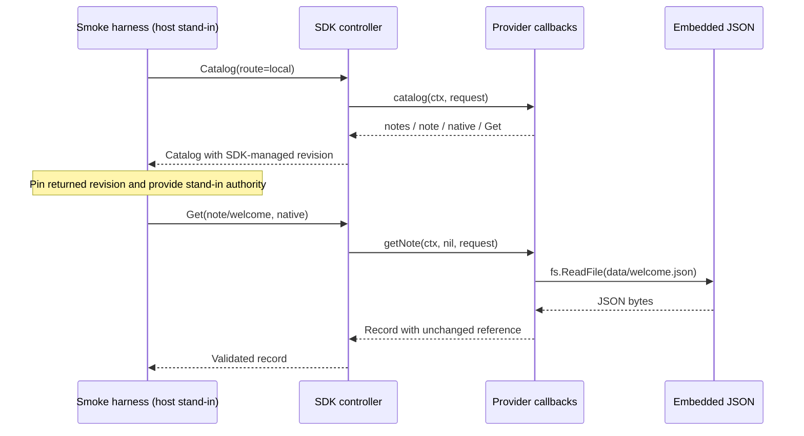

# Build a read-only resource plugin

> **API candidate:** Resource v2 is an API candidate. Check this repository's contracts when upgrading.

[Docs home](README.md) → Quickstart → [Resource tasks](resources.md)

## Goal

Run a plugin provider that reads an immutable JSON note. Then build its real host-facing entrypoint.

You will:

1. Discover the `notes` catalog through the `local` route.
2. Read `note/welcome` with a catalog revision pin.
3. Preserve an integer larger than JavaScript's exact integer range.
4. Build a binary that registers the provider and serves the SDK transport.

This example has no cloud service, Kubernetes dependency, client lifecycle, enumeration, writes, or watch stream. `native` means this provider's JSON representation.

## Prerequisites

- A checkout of this repository.
- Go 1.25 or newer, matching [go.mod](../go.mod).
- A terminal at the repository root. Go may download dependencies on the first run.

No running Omniview host or installed manifest is needed for the smoke path.

## 1. Run the provider

From the repository root:

```sh
GOWORK=off GOFLAGS= go run ./examples/resource-plugin --smoke
```

Expected output:

```text
catalog: provider=notes type=note representation=native get=true
record: authority=smoke-host id=welcome title=Welcome to resource plugins
sequence: kind=int64 value=9007199254740993
```

Checkpoint: the note was read from embedded JSON, not a fabricated client response. The integer retained its exact decimal value.

`--smoke` calls the actual controller's `Catalog` and pinned `Get` methods in-process. It does not test gRPC, host installation, or authorization. The harness explicitly stands in for the host with `smoke-host`; production code must use host-issued authority and grants. A catalog pin records an observation, not permission.

## 2. Find the moving parts

Repository tree:

```text
examples/resource-plugin/
├── main.go             # Plugin registration and smoke harness
├── provider.go         # Catalog and Get callbacks
├── plugin.yaml         # Host-readable plugin metadata
└── data/
    └── welcome.json    # Immutable resource body
```

| File | Read it for |
| --- | --- |
| [main.go](../examples/resource-plugin/main.go) | Process entrypoint, error handling, `Close`, and pinned smoke request |
| [provider.go](../examples/resource-plugin/provider.go) | Lifecycle-free controller, scoped capability, embedded file read |
| [plugin.yaml](../examples/resource-plugin/plugin.yaml) | Plugin ID `notes`, resource capability, SDK protocol metadata |
| [welcome.json](../examples/resource-plugin/data/welcome.json) | JSON strings, integer, boolean, list, and null |



## 3. Understand catalog and dispatch

`provider.go` — contextual excerpt from [`newProvider`](../examples/resource-plugin/provider.go):

```go
func newProvider() (*resourcev2.Controller[struct{}], error) {
	return resourcev2.NewController(resourcev2.Config[struct{}]{
		Catalog: catalog,
		Registrations: []resourcev2.Registration[struct{}]{{
			Type: resourceTypeID,
			Get:  getNote,
		}},
	})
}
```

`Catalog` is required. `Get` needs both a callback and a positive catalog capability. The catalog declares one type, one representation, and an empty scope because notes have no scope dimensions.

The private constants are `pluginID = "notes"`, `resourceTypeID = "note"`, and `representationID = "native"`.

`provider.go` — contextual excerpt from [`catalog`](../examples/resource-plugin/provider.go):

```go
Capabilities: []resourcev2.Capability{{
	Operation: resourcev2.OperationGet,
	Scope:     resourcev2.QueryScope{},
}},
```

No `Lifecycle` is configured. The controller can dispatch these callbacks with a nil client. `local` is an explicit logical route, not a network connection or an authority. The callback rejects other route names. A real host still owns connection selection and admission.

The controller manages catalog epochs. The smoke harness pins the returned revision rather than constructing an epoch itself.

## 4. Follow the read

`provider.go` — contextual excerpt from [`getNote`](../examples/resource-plugin/provider.go):

```go
body, err := resourcev2.JSONToValue(data)
if err != nil {
	return resourcev2.Record{}, &resourcev2.ResourceOperationError{
		Code: "INTERNAL", Message: "The embedded note could not be decoded.", Err: err,
	}
}
```

`getNote` accepts only the fixed `welcome` ID, then reads `data/welcome.json` with `fs.ReadFile`. It never turns arbitrary IDs into filesystem paths.

`JSONToValue` preserves supported scalar intent. Decoding through `map[string]any` first would turn numbers into `float64`. Native JSON strings stay strings, including timestamp-looking text.

The returned record copies `request.Reference` unchanged. Provider, host authority, type, scope, and ID identify the resource; `Route.Connection` only selects the access path.

The callback checks cancellation before work, after the file read, and after conversion. Embedded file reads are short synchronous reads; `fs.ReadFile` itself has no context parameter. Errors expose public-safe messages and retain raw causes in `Err`.

## 5. Build the host-facing binary

From the repository root:

```sh
GOWORK=off GOFLAGS= go build -o ./examples/resource-plugin/notes-plugin ./examples/resource-plugin
./examples/resource-plugin/notes-plugin --smoke
```

Checkpoint: the built binary prints the same three smoke lines.

`main.go` — contextual excerpt from [`run`](../examples/resource-plugin/main.go):

```go
plugin := sdk.NewPlugin(sdk.PluginOpts{ID: pluginID})
sdk.RegisterResourcePlugin(plugin, provider)
plugin.Serve()
```

Without `--smoke`, this is a host-launched plugin process, not a standalone HTTP server. The entrypoint closes the controller on return and joins any close error with the operation error. The SDK transport also supports provider retirement. This example has no external clients to release.

### Installation and launch boundary

The SDK does not supply a host installer or UI launcher in this repository. Use your host's plugin installation and launch workflow; the build command alone does not install the plugin.

Before launching the default entrypoint, the host must:

1. Install [plugin.yaml](../examples/resource-plugin/plugin.yaml) at `<selected-state-root>/plugins/notes/plugin.yaml`.
2. Launch the built executable through the SDK-compatible plugin transport.
3. Supply its selected state root and workspace context, then own connection admission, authority, and grants.

[`sdk.NewPlugin`](../pkg/sdk/plugin.go) reads this installed manifest, not the source-tree manifest or the executable's current directory. Its `id` must match `PluginOpts.ID`. Missing or mismatched metadata causes startup to panic.

[`state.ResolveRoot`](../pkg/state/root.go) uses absolute `OMNIVIEW_STATE_DIR` when supplied. Without workspace context it falls back to `$HOME/.omniview`. With `OMNIVIEW_WORKSPACE_FILE`, the host must supply a matching resolved state root. Do not guess a development profile path or copy files into a different host profile.

The manifest's `sdk_protocol_version: 1` describes SDK protocol metadata; it does not turn the resource API into v1. Resource wire negotiation is separate.

## Next

- [Resource tasks](resources.md): add operations and representations deliberately.
- [Connections](connections.md): introduce a real client lifecycle when your provider needs one.
- [Resource v2 API lookup](resource-v2-api.md): find request types and callback contracts.
