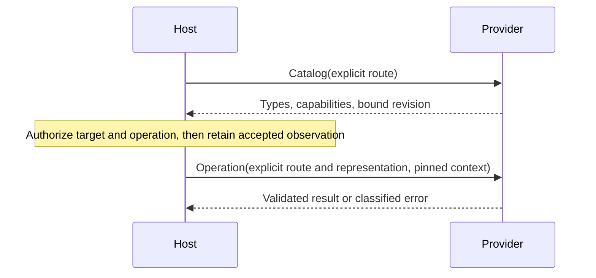

# Resource v2 API reference

**API status:** implementation candidate, not an approved public contract. This page describes current source behavior.

[Documentation home](README.md) · [Quickstart](quickstart.md) · [Resource tasks](resources.md) · [Connections](connections.md) · [Migration](sdk-v1-v2-overview.md)

Use this page to find interfaces, request fields, capabilities, values, and errors. Use [advanced contracts](resource-v2-contracts.md) for admission edge cases, ownership, limits, and pending decisions.

## Responsibilities and source map

| You need to… | Public surface | Source |
| --- | --- | --- |
| Discover types and support | `Provider`, `Catalog`, `ResourceType`, `Capability` | [domain.go](../pkg/resource/v2/domain.go) |
| Implement finite operations | `Getter`, `Enumerator`, `NativeQuerier`, `Mutator`, `Actioner` | [domain.go](../pkg/resource/v2/domain.go) |
| Compose callbacks and clients | `NewController`, `Config`, `Registration`, `Lifecycle` | [provider_options.go](../pkg/resource/v2/provider_options.go), [connections](connections.md) |
| Build exact bodies | `Value`, `JSONToValue`, `ValueFromNative`, `NativeFromValue`, `TimestampValue` | [value_json.go](../pkg/resource/v2/value_json.go), [domain.go](../pkg/resource/v2/domain.go) |
| Classify failures | `ResourceOperationError`, `NewError`, `ErrorClassifier`, `ErrorCode` | [errors.go](../pkg/resource/v2/errors.go) |
| Add metadata or streams | Optional ancillary and update interfaces | [Optional extensions](#optional-extensions) |
| Register plugin process | `sdk.RegisterResourcePlugin` | [Runnable quickstart](quickstart.md) |
| Add exec, logs, metrics, forwarding, tools, or commands | SDK capability registration | [SDK capabilities](capabilities.md) |

Providers define native semantics. The host authorizes access, issues authority, and pins accepted catalog observations. Transport adapters and generated protobuf messages are not required in provider handlers.

## Construction and examples

Only `Catalog` is required. Lifecycle, enumeration, writes, and watches are independent choices. `native` means provider-specific data, not Kubernetes data.

`pkg/resource/v2/domain.go` — contextual interface excerpts from [source](../pkg/resource/v2/domain.go). These declarations use the package's `context` import and domain types.

```go
type Provider interface {
	Catalog(context.Context, CatalogRequest) (Catalog, error)
}

type Getter interface {
	Get(context.Context, GetRequest) (Record, error)
}

type Enumerator interface {
	Enumerate(context.Context, EnumerateRequest) (SourcePage, error)
}

type NativeQuerier interface {
	NativeQuery(context.Context, NativeQueryRequest) (SourcePage, error)
}

type Mutator interface {
	Mutate(context.Context, MutationRequest) (Record, error)
}

type Actioner interface {
	Action(context.Context, ActionRequest) (Value, error)
}
```

Choose either composition:

1. Use `NewController(Config[T])` for callback dispatch, catalog binding epochs, admission, and result fences.
2. Implement `Provider` directly when you own those behaviors. See [custom provider generations](resource-v2-contracts.md#route-qualified-admission).

A controller without `Lifecycle` is valid. Its operation callbacks receive a nil client. Start with the [embedded notes plugin](quickstart.md); use [connections](connections.md) only when you need managed clients.

### Operation capability lookup

Support requires both a positive, matching scoped catalog capability and an implementation. A controller's broad method set does not advertise support.

| Catalog operation | Direct interface | Controller callback | Request → result |
| --- | --- | --- | --- |
| `OperationGet` (`get`) | `Getter` | `Registration.Get` | `GetRequest` → `Record` |
| `OperationEnumerate` (`enumerate`) | `Enumerator` | `Registration.Enumerate` | `EnumerateRequest` → `SourcePage` |
| `OperationNativeQuery` (`nativeQuery`) | `NativeQuerier` | `Registration.NativeQuery` | `NativeQueryRequest` → `SourcePage` |
| `OperationCreate` (`create`) | `Mutator` | `Registration.Mutate` | `MutationRequest{Operation: "create"}` → `Record` |
| `OperationMutationUpdate` (`mutationUpdate`) | `Mutator` | `Registration.Mutate` | `MutationRequest{Operation: "update"}` → `Record` |
| `OperationDelete` (`delete`) | `Mutator` | `Registration.Mutate` | `MutationRequest{Operation: "delete"}` → `Record` |
| `OperationAction` (`action`) | `Actioner` or `StreamingActioner` | `Registration.Action` for finite actions | `ActionRequest` → `Value` or action events |
| `OperationUpdate` (`update`) | `BestEffortUpdateProvider` | `Registration.Watch` | `ReadTarget` → advisory events |

Create, mutation update, and delete are independent. `OperationUpdate` never admits a write. Actions also need action descriptors.

### Controller registration lookup

| Field | Meaning |
| --- | --- |
| `Config.Catalog` | Required route-qualified discovery callback |
| `Config.Registrations` | Exact-type callback registrations |
| `Config.ResolveRegistration` | Optional dynamic resolver; return the requested type and matching route |
| `Config.DynamicUpdates` | Advertise dynamically resolved watch implementations during feature negotiation |
| `Config.Lifecycle` | Optional configured-client ownership; [setup](connections.md#choose-client-ownership) |
| `Config.ErrorClassifier` | Fallback classification after registration classifier declines |
| `Registration.Type` | Exact opaque type, never a wildcard |
| `Registration.Connection` | Restrict to one explicit route; empty permits any explicitly supplied route |
| `Registration.Scope` | Optional additional scope restriction; nil does not bypass catalog admission |
| `Registration.SyncPolicy` | Advisory startup policy; not finite-operation support |

Overlapping registrations for the same operation fail at dispatch. Keep registration scopes and lifecycle configuration immutable after construction.

## Route-qualified admission

Identity and access are separate:

| Type | Required information | Not… |
| --- | --- | --- |
| `ResourceAddress` | `Provider`, host-issued `Authority`, opaque `Type`, identity `Scope`, opaque `ID` | A connection selector |
| `ResourceReference` | `Address`; optional `Incarnation` observation | A source revision |
| `AccessRoute` | Explicit `Connection` | Identity, permission, or an implicit default |
| `ReadTarget` | `Route`, `Provider`, `Authority`, `Type`, query `Scope`, `Representation` | A host query plan |

`NativeAuthorityHint` is metadata only. Equal hints do not grant authority or establish sharing.



| Observation helper | Use |
| --- | --- |
| `WithCatalogRevision` | One explicit observation for a single-route source call |
| `WithCatalogRevisionForRoute` | Observation keyed by exact provider and route |
| `CheckCatalogRevisionForRoute` | Check current catalog against the selected observation |
| `NewCatalogBindingEpoch`, `BindCatalogRevision` | Custom-provider binding generations; controllers handle these automatically |

Pins are observations, not permissions. Do not replace a stale accepted pin with a fresh cached revision. Required missing or stale observations return `RESET_REQUIRED`.

Cross-route relationships need independently accepted target observations. Qualified observations override defaults; duplicates fail closed. See [full pin rules](resource-v2-contracts.md#route-qualified-admission).

### Scope lookup

| Shape | Meaning |
| --- | --- |
| Address `Scope` | Each declared identity dimension exactly once |
| `QueryScope` | Each declared query dimension exactly once; dimensions intersect |
| `ScopeAny` | Every value of one dimension; omit `Values` |
| `ScopeOneOf` | Exactly the nonnil `Values` selection |
| Empty `oneOf` | Matches nothing; return an honest empty page without broad acquisition |
| Empty query scope | Valid only when the type has no query dimensions |

Query-only dimensions cannot be inferred from identity. The current relationship result helper rejects query-only target dimensions absent from returned identity; see [known limitation](resource-v2-contracts.md#relationship-helper-limitation).

## Request and result lookup

All types below live in [domain.go](../pkg/resource/v2/domain.go). Request containers are borrowed read-only during calls. Return independently owned mutable results.

| Request | Fields beyond explicit route/reference/target |
| --- | --- |
| `CatalogRequest` | `Route` only; discovery does not implicitly start a client |
| `GetRequest` | `Route`, `Reference`, explicit `Representation` |
| `EnumerateRequest` | `Target`, `PageSize`, optional source `Cursor` |
| `NativeQueryRequest` | `Target`, `Language`, typed `Query`, `PageSize`, optional `Cursor` |
| `MutationRequest` | `Route`, `Reference`, `Operation`, typed `Input`, optional native `ExpectedRevision` |
| `ActionRequest` | `Route`, `Reference`, action name `Action`, typed `Input` |

`ExpectedRevision` is an optimistic-write observation, not a catalog pin. Canonical reads require an explicit representation. A host may resolve omitted UI selection only through the catalog's explicit `DefaultRepresentation`.

| Result | Required meaning |
| --- | --- |
| `Catalog` | `Provider`, supported `Types`, opaque bound `Revision`, honest `Coverage` |
| `Record` | Requested `Reference`, map-root `Body`, admitted `Representation`, honest `Coverage`; optional native `SourceRevision` |
| `SourcePage` | Stable `Records`, optional `NextCursor`, explicit `Count`, `Coverage`, `Consistency`, optional `SourceRevision` |
| `Representation` | Format `ID`, format-contract `Revision`, `Schema` binding |
| `SchemaBinding` | Distinguish `available`, `absent`, and acquisition-failed `unavailable` |

### Result metadata

| Value | Valid form |
| --- | --- |
| Complete coverage | `Coverage{Kind: "complete"}`; no paths or reason |
| Partial / unknown coverage | `Kind: "partial"` or `"unknown"`; public-safe `Reason` required; preserve path limitations |
| Unknown count | `Count{Kind: "unknown"}`; nil value, not zero |
| Exact / estimated count | `Kind: "exact"` or `"estimate"`; pointer to canonical unsigned decimal string |
| Page consistency | `"bestEffort"` or `"pointInTime"`; neither promises snapshot/live handoff |
| Cursor | Opaque source continuation; never reuse across changed target or generation |
| Available schema | Revision, dialect, exactly one inline document or document reference |
| Absent schema | No document binding; absence is not acquisition failure |
| Unavailable schema | No inline document; optional reviewed error code, never raw diagnostics |
| Schema validation | `full`: available, no unvalidated constraints; `reduced`: available, explicit unvalidated constraints; `none`: no constraint claims |

Schema roots are local RFC6901 URI-fragment pointers. Empty root selects the whole document. No implicit external loading or normalization occurs.

`SourcePage` is bounded source acquisition, not a host query/history engine. Failed discovery is an error, not empty complete coverage. On error, callers discard the accompanying result.

## Exact values

`Value` preserves scalar intent. Set exactly the selected payload; the zero value is invalid.

| Kind | Go payload | Tagged JSON example |
| --- | --- | --- |
| `null` | No payload | `{"kind":"null"}` |
| `bool` | `Bool` | `{"kind":"bool","value":false}` |
| `string` | `String` | `{"kind":"string","value":"welcome"}` |
| `int64` | Canonical decimal `Int` | `{"kind":"int64","value":"-9223372036854775808"}` |
| `uint64` | Canonical decimal `Uint` | `{"kind":"uint64","value":"18446744073709551615"}` |
| `double` | Finite `Double`; preserves negative zero | `{"kind":"double","value":-0}` |
| `timestamp` | UTC RFC3339 `Timestamp` | `{"kind":"timestamp","value":"2026-01-02T03:04:05Z"}` |
| `list` | `List`; selected nil means empty list | `{"kind":"list","value":[]}` |
| `map` | `Map`; selected nil means empty map | `{"kind":"map","value":{}}` |

Use `JSONToValue` for map-root native JSON documents. Integral tokens retain exact signed/unsigned intent; fractional/exponent tokens become doubles. JSON strings remain strings, even when they resemble timestamps.

`ValueFromNative` preserves supported Go scalar types without a JSON float round trip. Use `TimestampValue` for explicit time intent.

`values.go` — complete standalone program using [Value JSON encoding](../pkg/resource/v2/value_json.go).

```go
package main

import (
	"encoding/json"
	"fmt"

	resourcev2 "github.com/omniviewdev/plugin-sdk/pkg/resource/v2"
)

func main() {
	value, err := resourcev2.JSONToValue([]byte(`{"count":18446744073709551615}`))
	if err != nil {
		panic(err)
	}
	encoded, err := json.Marshal(value)
	if err != nil {
		panic(err)
	}
	fmt.Println(string(encoded))
}
```

Save `values.go` at the module root, then run:

```sh
GOWORK=off GOFLAGS= go run ./values.go
```

Expected output:

```json
{"kind":"map","value":{"count":{"kind":"uint64","value":"18446744073709551615"}}}
```

## Results and errors

Public error text must be safe for users. Never pass native error strings, credentials, private URLs, or configuration to `NewError`. It places detail directly in `Message` without redaction.

`pkg/resource/v2/errors.go` — contextual type excerpt from [source](../pkg/resource/v2/errors.go).

```go
type ResourceOperationError struct {
	Err         error    `json:"-"`
	Code        string   `json:"code"`
	Title       string   `json:"title"`
	Message     string   `json:"message"`
	Suggestions []string `json:"suggestions,omitempty"`
}
```

Keep raw diagnostics in `Err`. `Unwrap` exposes them locally; JSON and `Error()` exclude them. The host retains final redaction, trusted provenance, and recovery policy.

| Condition | Classification |
| --- | --- |
| Missing object | `NOT_FOUND` |
| Unsupported capability | `UNSUPPORTED` |
| Invalid canonical request | `INVALID_REQUEST` |
| Stale/missing required pin | `RESET_REQUIRED` |
| Retired source continuation | `CONTINUATION_EXPIRED` |
| Bounded payload/page exceeded | `RESOURCE_LIMIT` |
| Context cancellation / deadline | `CANCELLED` / `TIMEOUT` |
| Unknown error or unrecognized code | `INTERNAL` |

See [`IsErrorCode`](../pkg/resource/v2/errors.go) for the full accepted vocabulary. A classifier may decline with nil. Registration classifier runs before controller classifier; existing typed errors and cancellation retain classification.

## Optional extensions

Negotiate remote features through [`FeatureNegotiator`](../pkg/resource/v2/features.go). Static transport method sets do not prove support.

| Task | Interface / source | Key obligation |
| --- | --- | --- |
| Show connection inventory UI | `ConnectionBrowser` in [ancillary.go](../pkg/resource/v2/ancillary.go) | Discovery does not start clients |
| Discover dimension values | `ScopeValuesProvider` in [ancillary.go](../pkg/resource/v2/ancillary.go) | Values do not grant or constrain acquisition |
| Add display metadata | `PresentationProvider` in [ancillary.go](../pkg/resource/v2/ancillary.go) | Does not replace catalog capability declarations |
| Supply editor/schema documents | `EditorSchemaProvider`, `SchemaDocumentProvider` in [ancillary.go](../pkg/resource/v2/ancillary.go) | Preserve absence, failure, and validation states |
| Resolve native links | `RelationshipProvider` in [ancillary.go](../pkg/resource/v2/ancillary.go) | Explicit target routes, authorities, scopes, and observations |
| Report resource health/events | `HealthProvider` in [ancillary.go](../pkg/resource/v2/ancillary.go) | Resource health is not connection health |
| Describe/stream actions | `ActionCatalog`, `StreamingActioner` in [ancillary.go](../pkg/resource/v2/ancillary.go) | Exactly one `ready` after native establishment, before output |
| Publish advisory updates | `BestEffortUpdateProvider`, `WatchEventSink` in [updates.go](../pkg/resource/v2/updates.go) | No replay, gap-free continuity, or atomic handoff |

Framework owns stream channels and completion. Send events and return; never close framework-owned channels. See [stream lifetime contracts](resource-v2-contracts.md#utility-and-stream-lifetime).

## Export inventory

The [advanced export inventory](resource-v2-contracts.md#export-inventory) separates provider, host, utility, and transport audiences. Transport framing is not a provider-author API.

## Next steps

- [Add a resource operation](resources.md).
- [Own a native connection lifecycle](connections.md).
- [Migrate an existing provider](sdk-v1-v2-overview.md).
- Look up [concurrency and ownership](resource-v2-contracts.md#concurrency-and-ownership), [safety ceilings](resource-v2-contracts.md#safety-ceilings-and-exclusions), or [pending boundary decisions](resource-v2-contracts.md#cleanup-contract-decisions).
