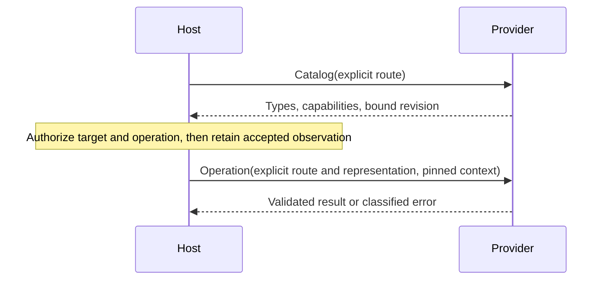

# Resource v2 API reference

**API status:** SDK v0.20.0 resource-v2 contract with resource RPC wire `3` and host callback broker `2`, targeting coordinated Omniview v0.36.0. Rebuild supported hosts and providers together; source documentation is not a publication or acceptance receipt.

[Documentation home](README.md) · [Quickstart](quickstart.md) · [Resource tasks](resources.md) · [Connections](connections.md) · [Migration](sdk-v1-v2-overview.md)

Use this page to find interfaces, request fields, capabilities, values, and errors. Migrate and rebuild resource consumers together; no legacy resource-method fallback is provided. Use [advanced contracts](resource-v2-contracts.md) for admission edge cases, ownership, limits, and historical design rationale.

## Responsibilities and source map

| You need to… | Public surface | Source |
| --- | --- | --- |
| Discover types and support | `Provider`, `Catalog`, `ResourceType`, `Capability` | [domain.go](../pkg/resource/v2/domain.go) |
| Implement finite operations | `Getter`, `Enumerator`, `NativeQuerier`, `Mutator`, `Actioner` | [domain.go](../pkg/resource/v2/domain.go) |
| Compose callbacks and clients | `NewController`, `Config`, `Registration`, `Lifecycle` | [provider_options.go](../pkg/resource/v2/provider_options.go), [connections](connections.md) |
| Build exact bodies | `Value`, `JSONToValue`, `ValueFromNative`, `NativeFromValue`, `TimestampValue` | [value_json.go](../pkg/resource/v2/value_json.go), [domain.go](../pkg/resource/v2/domain.go) |
| Classify failures | `ResourceOperationError`, `NewError`, `ErrorClassifier`, `ErrorCode` | [errors.go](../pkg/resource/v2/errors.go) |
| Add metadata or streams | Optional ancillary and update interfaces | [Optional extensions](#optional-extensions) |
| Register plugin process | `sdk.RegisterResourcePlugin` | [Runnable quickstart](quickstart.md) |
| Add exec, logs, metrics, forwarding, tools, or commands | SDK capability registration | [SDK capabilities](capabilities.md) |

Providers define native semantics. The host authorizes access, issues authority, and pins accepted catalog observations. Transport adapters and generated protobuf messages are not required in provider handlers.

`CatalogRequest{Route, Refresh}` separates observation from discovery. Default `Refresh: false` observes installed support without native discovery or schema acquisition. Explicit eligible refresh owns its discovery errors and cannot poison ordinary observation of a valid snapshot. Initial native identity, scope, and discovery remain mandatory and fail closed. Optional schema resolution never enters the support revision.

## Construction and examples

Only `Catalog` is required. Lifecycle, enumeration, writes, and source sessions are independent choices. `native` means provider-specific data, not Kubernetes data.

`pkg/resource/v2/domain.go` — contextual interface excerpts from [source](../pkg/resource/v2/domain.go). These declarations use the package's `context` import and domain types.

```go
type Provider interface {
	Catalog(context.Context, CatalogRequest) (Catalog, error)
}

type Getter interface {
	Get(context.Context, GetRequest) (Record, error)
}

type Enumerator interface {
	Enumerate(context.Context, EnumerateRequest) (SourcePage, error)
}

type NativeQuerier interface {
	NativeQuery(context.Context, NativeQueryRequest) (SourcePage, error)
}

type Mutator interface {
	Mutate(context.Context, MutationRequest) (Record, error)
}

type Actioner interface {
	Action(context.Context, ActionRequest) (Value, error)
}
```

Choose either composition:

1. Use `NewController(Config[T])` for callback dispatch, catalog binding epochs, admission, and result fences.
2. Implement `Provider` directly when you own those behaviors. See [custom provider generations](resource-v2-contracts.md#route-qualified-admission).

A controller without `Lifecycle` is valid. Its operation callbacks receive a nil client. Start with the [embedded notes plugin](quickstart.md); use [connections](connections.md) only when you need managed clients.

### Operation capability lookup

Support requires both a positive, matching scoped catalog capability and an implementation. A controller's broad method set does not advertise support.

| Catalog operation | Direct interface | Controller callback | Request → result |
| --- | --- | --- | --- |
| `OperationGet` (`get`) | `Getter` | `Registration.Get` | `GetRequest` → `Record` |
| `OperationEnumerate` (`enumerate`) | `Enumerator` | `Registration.Enumerate` | `EnumerateRequest` → `SourcePage` |
| `OperationNativeQuery` (`nativeQuery`) | `NativeQuerier` | `Registration.NativeQuery` | `NativeQueryRequest` → `SourcePage` |
| `OperationCreate` (`create`) | `Mutator` | `Registration.Mutate` | `MutationRequest{Operation: "create"}` → `Record` |
| `OperationMutationUpdate` (`mutationUpdate`) | `Mutator` | `Registration.Mutate` | `MutationRequest{Operation: "update"}` → `Record` |
| `OperationDelete` (`delete`) | `Mutator` | `Registration.Mutate` | `MutationRequest{Operation: "delete"}` → `Record` |
| `OperationAction` (`action`) | `Actioner` or `StreamingActioner` | `Registration.Action` for finite actions | `ActionRequest` → `Value` or action events |
| `OperationSourceUpdates` (`sourceUpdates`) | `SourceProvider` | `Registration.Source` | `SourceOpenRequest` → snapshot and changes |

Create, mutation update, and delete are independent. Source updates never admit a write. Discovered actions also need action descriptors; action discovery remains optional for native callers.

### Controller registration lookup

| Field | Meaning |
| --- | --- |
| `Config.Catalog` | Required route-qualified discovery callback |
| `Config.Registrations` | Exact-type callback registrations |
| `Config.ResolveRegistration` | Optional dynamic resolver; return the requested type and matching route |
| `Config.DynamicSources` | Advertise dynamically resolved source callbacks during feature negotiation |
| `Config.Lifecycle` | Optional configured-client ownership; [setup](connections.md#choose-client-ownership) |
| `Config.ErrorClassifier` | Fallback classification after registration classifier declines |
| `Registration.Type` | Exact opaque type, never a wildcard |
| `Registration.Connection` | Restrict to one explicit route; empty permits any explicitly supplied route |
| `Registration.Scope` | Optional additional scope restriction; nil does not bypass catalog admission |
| `Registration.Source` | Emit the snapshot boundary and subsequent changes for an admitted source |
| `Registration.Actions` | Optional finite-action descriptors; when supplied, undeclared action names are rejected |

Overlapping registrations for the same operation fail at dispatch. Keep registration scopes and lifecycle configuration immutable after construction.

## Route-qualified admission

Identity and access are separate:

| Type | Required information | Not… |
| --- | --- | --- |
| `ResourceAddress` | `Provider`, host-issued `Authority`, opaque `Type`, identity `Scope`, opaque `ID` | A connection selector |
| `ResourceReference` | `Address`; optional `Incarnation` observation | A source revision |
| `AccessRoute` | Explicit `Connection` | Identity, permission, or an implicit default |
| `ReadTarget` | `Route`, `Provider`, `Authority`, `Type`, query `Scope`, `Representation` | A host query plan |

`NativeAuthorityHint` is metadata only. Equal hints do not grant authority or establish sharing.



| Observation helper | Use |
| --- | --- |
| `WithCatalogRevision` | One explicit observation for a single-route source call |
| `WithCatalogRevisionForRoute` | Observation keyed by exact provider and route |
| `CheckCatalogRevisionForRoute` | Check current catalog against the selected observation |
| `NewCatalogBindingEpoch`, `BindCatalogRevision` | Custom-provider binding generations; controllers handle these automatically |

Pins are observations, not permissions. Do not replace a stale accepted pin with a fresh cached revision. Required missing or stale observations return `RESET_REQUIRED`.

Cross-route relationships need independently accepted target observations. Qualified observations override defaults; duplicates fail closed. See [full pin rules](resource-v2-contracts.md#route-qualified-admission).

The controller retains its configured native-generation lease through admitted
work and rejects late results after cancellation or retirement. An advertised
catalog/descriptor observation is not replaced with a fresh one to make a stale
request succeed. These fences are not rollback guarantees: a native side effect
may have begun before cancellation or retirement is observed.

### Scope lookup

| Shape | Meaning |
| --- | --- |
| Address `Scope` | Each declared identity dimension exactly once |
| `QueryScope` | Each declared query dimension exactly once; dimensions intersect |
| `ScopeAny` | Every value of one dimension; omit `Values` |
| `ScopeOneOf` | Exactly the nonnil `Values` selection |
| Empty `oneOf` | Matches nothing; return an honest empty page without broad acquisition |
| Empty query scope | Valid only when the type has no query dimensions |

Query-only dimensions cannot be inferred from identity. The current relationship result helper rejects query-only target dimensions absent from returned identity; see [known limitation](resource-v2-contracts.md#relationship-helper-limitation).

## Request and result lookup

All types below live in [domain.go](../pkg/resource/v2/domain.go). Request containers are borrowed read-only during calls. Return independently owned mutable results.

| Request | Fields beyond explicit route/reference/target |
| --- | --- |
| `CatalogRequest` | `Route`, optional `Refresh` for explicit discovery refresh; discovery does not implicitly start a client |
| `GetRequest` | `Route`, `Reference`, explicit `Representation` |
| `EnumerateRequest` | `Target`, `PageSize`, optional source `Cursor` |
| `NativeQueryRequest` | `Target`, `Language`, typed `Query`, `PageSize`, optional `Cursor` |
| `MutationRequest` | `Route`, `Reference`, `Operation`, typed `Input`, optional native `ExpectedRevision` |
| `ActionRequest` | `Route`, exactly one of `Reference` or `TypeTarget`, action name `Action`, typed `Input` |

`ExpectedRevision` is an optimistic-write observation, not a catalog pin. Canonical reads require an explicit representation. A host may resolve omitted UI selection only through the catalog's explicit `DefaultRepresentation`.

### Native query discovery and model representations

`ResourceType.NativeQueries` lists `NativeQueryDescriptor` values with a `Language`, optional author-facing `Description`, and an object-root `InputSchema`. This metadata describes the provider's existing native-query operation; it does not add a query engine or imply enumeration support. Keep the independent `OperationNativeQuery` capability and callback. When descriptors are present, admission rejects undeclared languages and validates the query against the declared schema. An omitted descriptor list preserves an opaque provider-native query contract.

```go
descriptor.NativeQueries = []resourcev2.NativeQueryDescriptor{{
    Language: "labels.v1",
    Description: "Select objects using the provider's label expression syntax.",
    InputSchema: resourcev2.Schema{
        Properties: map[string]resourcev2.SchemaProperty{
            "selector": {Type: resourcev2.SchemaString},
        },
        Required: []string{"selector"},
    },
}}
```

`ResourceType.ModelRepresentation` optionally names a declared representation for model consumers. It does not change `DefaultRepresentation`, which continues to serve existing UI selection. Both fields must reference declared IDs. A type-level hint avoids adding purpose labels to every representation or hard-coding provider-specific projections in the host. Neither hint grants capability or changes record coverage.

`ResourceType.Description` optionally describes the resource type for human or model consumers. Empty descriptions are omitted from JSON; omission does not block catalog discovery. Explicit JSON `null` is invalid, as for other optional string metadata. Catalog transport preserves the text without interpreting it as instructions or granting capabilities. Older SDK receivers with strict unknown-field admission require a compatible SDK upgrade before providers send nonempty descriptions.

### Action targets and schemas

Instance actions use `ActionRequest.Reference`. Type actions leave `Reference` zero-valued and supply `TypeTarget: &resourcev2.TypeActionTarget{Provider: provider, Authority: authority, Type: typ, Scope: scope}`. The route remains explicit in both cases. Do not fabricate an object ID for a type action. Admission validates the type target's complete query scope against catalog dimensions and independently advertised action capability.

Controller authors describe actions with `Registration.Actions`; direct providers optionally implement `ActionCatalog.GetActions`. When supplied, descriptors constrain the target, lane, input, and output. `Streaming: false` admits only the unary lane; `Streaming: true` requires the separate streaming interface and lane. Do not advertise streaming when only a unary callback exists. A nil registration descriptor list or absent optional discovery preserves native action dispatch without claiming schema validation; an explicitly empty descriptor list advertises no actions. MCP consumers omit actions without discovery metadata.

`ActionRequest.ExpectedDescriptor` optionally retains the immutable advertised descriptor through transport. Model-generated calls supply it so changed action metadata cannot inherit earlier consent. Before native execution the selected descriptor must match; a changed or missing declaration returns `RESET_REQUIRED` and requires rediscovery, never an automatic write retry. Invalid present descriptors return `INVALID_REQUEST`. Nil means no advertised expectation, not permission or a schema claim.

Action discovery preserves nil (unknown metadata) versus a nonnil empty list (explicitly no advertised actions) across transport. Controller registration, discovery, and resolution own independent copies of nested ancillary schemas, so later caller mutations cannot change an accepted descriptor observation.

Disjoint scoped registrations may reuse an action ID with identical descriptors; route/type discovery emits it once. If descriptors for that ID differ, unscoped discovery omits that ID rather than advertising a wider schema. Request admission still resolves the exact scoped controller registration and validates its descriptor.

This is a transport discovery limitation: action discovery accepts only route and type, not query scope. Ambiguous scoped IDs are therefore not remotely discoverable or dispatchable through catalog-driven transport consumers. Direct controller callers can still dispatch an explicit scoped target and receive validation against its selected registration. Use distinct action IDs or identical descriptors when those actions must be exposed remotely.

Ancillary `Schema` is deliberately an object-root subset, not full JSON Schema. It supports property types, required properties, string enums, numeric minimum/maximum, and nested object properties/required lists. Array item constraints and other undeclared constraints are unsupported. Declarations reject unknown fields and invalid combinations rather than dropping assertions. Input and output validation preserves canonical `Value` kinds and exact integers. Defaults are rejected and never applied; no coercion occurs. Nil action schemas mean no supplied constraint claim, not successful schema validation.

Numeric bounds use finite Go `float64` values. JSON declarations must express those bounds exactly; declarations requiring rounding are rejected rather than silently changing a constraint. Canonical integer inputs are compared against the exact declared binary bound without conversion to floating point.

Relationship bindings may include an explicit `any` query-only dimension absent from target identity. A restricted query-only dimension cannot be proven from identity alone and remains rejected.

| Result | Required meaning |
| --- | --- |
| `Catalog` | `Provider`, supported `Types`, opaque bound `Revision`, honest `Coverage` |
| `Record` | Requested `Reference`, map-root `Body`, admitted `Representation`, honest `Coverage`; optional native `SourceRevision` |
| `SourcePage` | Stable `Records`, optional `NextCursor`, explicit `Count`, `Coverage`, `Consistency`, optional `SourceRevision` |
| `Representation` | Body-format `ID` and format-contract `Revision` only; shared by finite and source records |
| `SchemaBinding` | Optional targeted observation: distinguish `available`, `absent`, and acquisition-failed `unavailable` |

### Result metadata

| Value | Valid form |
| --- | --- |
| Complete coverage | `Coverage{Kind: "complete"}`; no paths or reason |
| Partial / unknown coverage | `Kind: "partial"` or `"unknown"`; public-safe `Reason` required; each `Paths` entry is an RFC6901 JSON pointer starting with `/` naming a limited body subtree; empty `Paths` means the limitation is not localized |
| Unknown count | `Count{Kind: "unknown"}`; nil value, not zero |
| Exact / estimated count | `Kind: "exact"` or `"estimate"`; pointer to canonical unsigned decimal string |
| Page consistency | `"bestEffort"` or `"pointInTime"`; neither promises snapshot/live handoff |
| Cursor | Opaque source continuation; never reuse across changed target or generation |
| Available schema | Revision, non-empty dialect, exactly one inline document or document reference; `DialectJSONSchema202012`, `DialectJSONSchemaDraft07`, `DialectOpenAPI30` name the dialects the host catalog normalizes |
| Absent schema | No document binding; absence is not acquisition failure |
| Unavailable schema | No inline document; optional reviewed error code, never raw diagnostics |
| Auxiliary schema target | `AuxiliarySchemaTarget{Key, Reference, SourceRevision}` selects one exact resource; `Key` is 1–256 UTF-8 bytes without control characters; optional `SourceRevision` is nonempty when present |

Schema roots are local RFC6901 URI-fragment pointers. For JSON Schema dialects an empty root selects the whole document. For `DialectOpenAPI30` the root MUST name a `#/components/schemas/<name>` entry. No implicit external loading or normalization occurs. Bindings carry no validation claims: the host schema catalog is the only normalizer and validation authority, and JSON bindings with `validation` or `unvalidated` members are rejected as unknown fields.

Schemas do not belong to catalog representations, body provenance, or source identity. Optional `SchemaResolver.ResolveSchema(ctx, SchemaRequest)` resolves exactly one selected target. `SchemaRequest` contains `Route`, `Type`, and `Target`; `SchemaTarget` contains exactly one `Representation *Representation` or `Auxiliary *AuxiliarySchemaTarget`. Resolve catalog defaults before constructing an explicit format ID/revision. Auxiliary selection names one exact resource/key/revision, never all releases or a URL. Missing `FeatureSchemaResolver` means unsupported enrichment, not known absence.

`ValidateSchemaBinding` validates a returned observation without allocating a protobuf tree or acquiring documents. `SchemaDocumentProvider.GetSchemaDocument(ctx, route, exactRef)` is an internal lookup for currently held demanded documents; it must never substitute a newer revision. Public host/broker access instead takes `SchemaDocumentRequest{Request: SchemaRequest, Reference: exactRef}`. Independently admit current principal, grant, route, type, target, and exact resolved association before and after acquisition. Shared bytes, group/version documents, and digests do not grant access. Providers never supply editor model URIs or file matches.

`SourcePage` is bounded source acquisition, not a host query/history engine. Failed discovery is an error, not empty complete coverage. On error, callers discard the accompanying result.

## Exact values

`Value` preserves scalar intent. Set exactly the selected payload; the zero value is invalid.

| Kind | Go payload | Tagged JSON example |
| --- | --- | --- |
| `null` | No payload | `{"kind":"null"}` |
| `bool` | `Bool` | `{"kind":"bool","value":false}` |
| `string` | `String` | `{"kind":"string","value":"welcome"}` |
| `int64` | Canonical decimal `Int` | `{"kind":"int64","value":"-9223372036854775808"}` |
| `uint64` | Canonical decimal `Uint` | `{"kind":"uint64","value":"18446744073709551615"}` |
| `double` | Finite `Double`; preserves negative zero | `{"kind":"double","value":-0}` |
| `timestamp` | UTC RFC3339 `Timestamp` | `{"kind":"timestamp","value":"2026-01-02T03:04:05Z"}` |
| `list` | `List`; selected nil means empty list | `{"kind":"list","value":[]}` |
| `map` | `Map`; selected nil means empty map | `{"kind":"map","value":{}}` |

Use `JSONToValue` for map-root native JSON documents. Integral tokens retain exact signed/unsigned intent; fractional/exponent tokens become doubles. JSON strings remain strings, even when they resemble timestamps.

`ValueFromNative` preserves supported Go scalar types without a JSON float round trip. Use `TimestampValue` for explicit time intent.

`values.go` — complete standalone program using [Value JSON encoding](../pkg/resource/v2/value_json.go).

```go
package main

import (
	"encoding/json"
	"fmt"

	resourcev2 "github.com/omniviewdev/plugin-sdk/pkg/resource/v2"
)

func main() {
	value, err := resourcev2.JSONToValue([]byte(`{"count":18446744073709551615}`))
	if err != nil {
		panic(err)
	}
	encoded, err := json.Marshal(value)
	if err != nil {
		panic(err)
	}
	fmt.Println(string(encoded))
}
```

Save `values.go` at the module root, then run:

```sh
GOWORK=off GOFLAGS= go run ./values.go
```

Expected output:

```json
{"kind":"map","value":{"count":{"kind":"uint64","value":"18446744073709551615"}}}
```

## Results and errors

Public error text must be safe for users. Never pass native error strings, credentials, private URLs, or configuration to `NewError`. It places detail directly in `Message` without redaction.

`pkg/resource/v2/errors.go` — contextual type excerpt from [source](../pkg/resource/v2/errors.go).

```go
type ResourceOperationError struct {
	Err         error    `json:"-"`
	Code        string   `json:"code"`
	Title       string   `json:"title"`
	Message     string   `json:"message"`
	Suggestions []string `json:"suggestions,omitempty"`
}
```

Keep raw diagnostics in `Err`. `Unwrap` exposes them locally; JSON and `Error()` exclude them. The host retains final redaction, trusted provenance, and recovery policy.

| Condition | Classification |
| --- | --- |
| Missing object | `NOT_FOUND` |
| Unsupported capability | `UNSUPPORTED` |
| Invalid canonical request | `INVALID_REQUEST` |
| Stale/missing required pin | `RESET_REQUIRED` |
| Retired source continuation | `CONTINUATION_EXPIRED` |
| Bounded payload/page exceeded | `RESOURCE_LIMIT` |
| Context cancellation / deadline | `CANCELLED` / `TIMEOUT` |
| Unknown error or unrecognized code | `INTERNAL` |

See [`IsErrorCode`](../pkg/resource/v2/errors.go) for the full accepted vocabulary. A classifier may decline with nil. Registration classifier runs before controller classifier; existing typed errors and cancellation retain classification.

## Optional extensions

Negotiate remote features through [`FeatureNegotiator`](../pkg/resource/v2/features.go). Static transport method sets do not prove support.

| Task | Interface / source | Key obligation |
| --- | --- | --- |
| Show connection inventory UI | `ConnectionBrowser` in [ancillary.go](../pkg/resource/v2/ancillary.go) | Discovery does not start clients |
| Discover dimension values | `ScopeValuesProvider` in [ancillary.go](../pkg/resource/v2/ancillary.go) | Values do not grant or constrain acquisition |
| Add display metadata | `PresentationProvider` in [ancillary.go](../pkg/resource/v2/ancillary.go) | Does not replace catalog capability declarations |
| Resolve one selected schema and held documents | `SchemaResolver`, `SchemaDocumentProvider` in [ancillary.go](../pkg/resource/v2/ancillary.go) | Explicit target; preserve absence/failure; exact-reference document lookup |
| Resolve native links | `RelationshipProvider` in [ancillary.go](../pkg/resource/v2/ancillary.go) | Explicit target routes, authorities, scopes, and observations |
| Report resource health/events | `HealthProvider` in [ancillary.go](../pkg/resource/v2/ancillary.go) | Resource health is not connection health |
| Describe/stream actions | `ActionCatalog`, `StreamingActioner` in [ancillary.go](../pkg/resource/v2/ancillary.go) | Exactly one `ready` after native establishment, before output |
| Publish source sessions | `SourceProvider`, `SourceEmitter` in [source.go](../pkg/resource/v2/source.go) | Emit snapshot, snapshot boundary, then changes; declare honest continuity |

Source sessions begin with a framework-issued `begin` frame. Providers emit snapshot observations and call `EndSnapshot` with coverage and continuity before sending changes. Snapshot-only sessions terminate at the boundary; update sessions terminate with reset or failure. Catalog `sourceUpdates` capabilities declare `gapFree` or `bestEffort` continuity. Existing explicit non-Kubernetes `AcquireOnConnect` policy still requires that capability; it does not make every connection an inventory consumer. Hosts supply session and generation tokens and frame limits, and must reopen after a reset.

`SourceOpenRequest.Binding` supplies the selected `Representation{ID, Revision}` once per generation. Finite `Record` and compact `SourceRecord` use that same format type. Observations retain tagged `Value` bodies, per-record coverage, and independent `DocumentCoverage.KnownAbsent` paths. Frame sequences use unsigned decimal strings in JSON; protobuf retains `uint64`. `CompactSourceRecord` adapts a finite record without schema copies.

Initial finite/source dispatch requires the exact accepted catalog observation. Ongoing source checks use `SourceOperationalContractEqual` and `CheckSourceCatalog`: retain the originally captured native binding epoch, selected type/format/operation/scope, identity/query dimensions, and continuity. Presentation, unselected support, and global catalog revision do not retire a healthy selected source. Partial discovery cannot prove withdrawal or grant unobserved support. Schema observations never change source identity.

Source admission also requires an SDK-owned `CatalogBindingEpoch`; custom providers issue and bind that epoch through the existing catalog helpers. A source-updates operation owns its snapshot and changes; it does not require or grant independent finite enumeration. Snapshot-only finite/native-query adapters still admit their actual acquisition operation, including opaque native-query contracts without schema metadata.

Resource wire version `3` explicitly rejects incompatible version-`2` cohorts before changed payload interpretation. The old bare-route catalog request tag, schema-bearing representation tag, compact schema-revision tag, and bulk editor-list result tag are retired, not reinterpreted. Independently supported host v1/finite adapters must normalize to this contract and demand schemas separately; they do not fabricate source-session support.

Framework owns stream channels and completion. Send events and return; never close framework-owned channels. See [stream lifetime contracts](resource-v2-contracts.md#utility-and-stream-lifetime).

### Source-session transport

This SDK uses scoped receive controls from the maintained
[`omniviewdev/grpc-go`](https://github.com/omniviewdev/grpc-go) fork.
Its module path remains `google.golang.org/grpc`.

Go does not inherit dependency replacements. Each application or plugin module
that consumes this SDK must select the same fork in its own root `go.mod`:

```sh
grpc_fork=github.com/omniviewdev/grpc-go
grpc_version=v1.85.1-0.20261107225428-6ba964c95af2
go mod edit \
  "-replace=google.golang.org/grpc=${grpc_fork}@${grpc_version}"
go mod tidy
```

The host and Kubernetes plugin have independent module roots. An unchanged
provider that uses SDK v0.10.0 can retain stock gRPC.

For this SDK, compilation fails without the root replacement because stock
gRPC does not provide the scoped receive APIs.

The controls require native `grpc.Server.Serve`. Configured methods fail with
`FailedPrecondition` under `ServeHTTP`; that transport cannot enforce these
ingress bounds.

A partial message has a five-second deadline. A healthy wait between complete
messages has no partial-read timer. An ordinary message timeout cancels only its
RPC. A physical HTTP/2 DATA frame has a separate absolute five-second deadline;
progress does not extend it. If that frame remains incomplete, the transport
closes the broken connection because HTTP/2 cannot parse another frame through
missing bytes.

Use `IsFatalSourceTransportError` from `pkg/resource/v2/plugin` to identify this
local transport failure. Retire the unhealthy provider transport. Do not infer
the failure from an error message or treat every RPC timeout as connection loss.

### Resource log-session ownership

Use the existing logs capability's `ResourceSessionProvider.CreateResourceSession`,
not a second client registry or custom resource-log tool. Canonical resource data
stays a `Value`; supplied references and routes are validated actual bindings,
not fabricated prerequisites. An explicit route must match the selected
connection metadata; absent metadata does not grant a connection or authority.

`CreateSessionOptions.SessionID` is an optional caller-chosen UUID for acceptance
and cleanup correlation. It grants no authority and does not make creation
idempotent. If an owner supplies an ID, it must close that ID after a failed or
lost acceptance response rather than retrying creation blindly.

The returned session is an acceptance receipt, not native readiness. Admission
inherits creation cancellation; once accepted, producer lifetime is independent
of that initiating RPC. Close, shutdown, or generation retirement cancels the
session and fences late output. The SDK retains the existing native-generation
lease until every native producer actually exits; cancellation alone is not
evidence of drain or permission to destroy an in-use client. Handlers must honor
their accepted context and close native readers so draining can finish.

## Export inventory

The [advanced export inventory](resource-v2-contracts.md#export-inventory) separates provider, host, utility, and transport audiences. Transport framing is not a provider-author API.

## Next steps

- [Add a resource operation](resources.md).
- [Own a native connection lifecycle](connections.md).
- [Migrate an existing provider](sdk-v1-v2-overview.md).
- Look up [concurrency and ownership](resource-v2-contracts.md#concurrency-and-ownership), [safety ceilings](resource-v2-contracts.md#safety-ceilings-and-exclusions), or [recorded boundary decisions](resource-v2-contracts.md#cleanup-contract-decisions).
