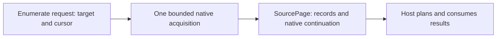

# Expose resources

[Docs home](README.md) · [Quickstart](quickstart.md) · [API reference](resource-v2-api.md)

> [!IMPORTANT]
> Resource v2 is an API candidate. This guide describes the current implementation.

Start with the [runnable notes plugin](../examples/resource-plugin). It advertises one type and implements only point reads. Add another operation only when your backend can honor its contract.

## 1. Declare the resource type

In your catalog callback, describe the type, its available representation, and supported operations. From [`provider.go`](../examples/resource-plugin/provider.go), inside the catalog's `Types` slice:

```go
{
    Type:                  resourceTypeID,
    DisplayName:           "Note",
    Representations:       []resourcev2.Representation{nativeRepresentation()},
    DefaultRepresentation: representationID,
    Capabilities: []resourcev2.Capability{{
        Operation: resourcev2.OperationGet,
        Scope:     resourcev2.QueryScope{},
    }},
},
```

This is a contextual struct-literal excerpt. The same file defines `resourceTypeID = "note"`, `representationID = "native"`, and `nativeRepresentation`. Empty scope is deliberate: notes have no identity or query dimensions.

A capability declares **support**, not permission. The host still authorizes each request. The catalog revision describes the observation used for admission; do not substitute a newly fetched revision for one the caller accepted.

## 2. Connect the operation to code

The controller registration must agree with the catalog. The example's complete constructor is:

```go
func newProvider() (*resourcev2.Controller[struct{}], error) {
    return resourcev2.NewController(resourcev2.Config[struct{}]{
        Catalog: catalog,
        Registrations: []resourcev2.Registration[struct{}]{{
            Type: resourceTypeID,
            Get:  getNote,
        }},
    })
}
```

Both pieces matter: a callback alone does not advertise support, and a capability alone does not implement it. The controller also has Go methods for operations this example does not support; method presence is not capability discovery.

For a custom provider, implement the required `Catalog` method plus only the optional interfaces you need. See [API: provider interfaces](resource-v2-api.md).

## 3. Return the admitted resource

The [Get callback](../examples/resource-plugin/provider.go) reads the fixed embedded file, converts it with `JSONToValue`, and returns this record:

```go
return resourcev2.Record{
    Reference:      request.Reference,
    Representation: nativeRepresentation(),
    Body:           body,
    Coverage:       resourcev2.Coverage{Kind: "complete"},
}, nil
```

This excerpt follows acquisition and validation in `getNote`; `request` and `body` come from that function. Preserve the requested identity and representation. Returning a different object under the original reference is not an acceptable fallback.

### Keep identity and access separate

| Incoming field | Meaning | Provider responsibility |
| --- | --- | --- |
| `request.Reference.Address` | Provider, host authority, opaque type, identity scope, ID | Resolve native identity without inventing or replacing host authority. |
| `request.Reference.Incarnation` | Optional observation of object recreation | Preserve and validate the observation when the backend supports it. |
| `request.Route.Connection` | Access path selected by the caller | Use that route; do not choose the first active client. |
| `request.Representation` | Admitted resource format | Return that representation, not an implicit provider default. |

“Native” can mean a database row, cloud document, hypervisor object, or embedded file. The SDK does not require a namespace, GVK, or Kubernetes metadata envelope.

## 4. Preserve native values

Use `JSONToValue` for a native JSON object or `ValueFromNative` for already-typed Go data. Do not pass exact integers through a `map[string]any` JSON decode first: the standard decoder's default `float64` conversion can lose precision.

```go
func counterBody() (resourcev2.Value, error) {
    return resourcev2.ValueFromNative(map[string]any{
        "sequence": int64(9007199254740993),
        "active":   true,
        "optional": nil,
    })
}
```

This independent helper uses the `resourcev2` import shown in the [example provider](../examples/resource-plugin/provider.go). Resource bodies currently require a map root. A timestamp-looking JSON string stays a string; use `TimestampValue` when the native value is actually a timestamp.

## 5. Add operations deliberately

| Backend can… | Add implementation | Advertise |
| --- | --- | --- |
| Read one addressed object | `Getter` or registration `Get` | `OperationGet` |
| Acquire a finite source page | `Enumerator` or `Enumerate` | `OperationEnumerate` |
| Execute its own query language | `NativeQuerier` or `NativeQuery` | `OperationNativeQuery` |
| Create, update, or delete | `Mutator` or `Mutate` | Each supported verb separately: `OperationCreate`, `OperationMutationUpdate`, `OperationDelete` |
| Execute a named operation | `Actioner` or `Action` | `OperationAction` |
| Emit advisory changes | Optional update provider or watch callback | The relevant update support with the best-effort guarantee |

**`OperationUpdate` means advisory updates, not a write.** `MutationRequest.Operation` is still `"create"`, `"update"`, or `"delete"`.

### Enumeration returns source pages



Return explicit coverage and consistency even for an empty page:

- `Count{Kind: "unknown"}` means no total is known; it is not zero.
- Partial or unknown coverage needs a real public-safe reason, such as `"Only the selected account was accessible."`; do not conceal an acquisition error as an empty page.
- `NextCursor` is the backend's continuation, not a portable host-query cursor.
- An empty `oneOf` selection matches nothing. Never reinterpret it as `any` or run a broad query instead.

For real clients, bound native acquisition and honor request cancellation. A finite page does not promise snapshot-to-watch continuity or implement the host's search/history engine.

## 6. Add metadata only when useful

Schemas, presentation, relationships, health, and diagnostic events are independent optional traits. Start with the [extension map](resource-v2-api.md), rather than fabricating empty implementations.

> [!WARNING]
> Relationship target matching currently rejects a query-only dimension that is absent from object identity, even for `any`. Review the [known portability limitation](sdk-v1-v2-overview.md#known-limitations) before building that integration. Do not add invented identity coordinates as a workaround.

## Before connecting a real backend

- Return public-safe error messages; retain raw causes in `ResourceOperationError.Err`.
- Honor cancellation and synchronize native state shared by concurrent callbacks.
- Return independently owned maps/slices; do not recycle buffers while callers use them.
- Use [connection lifecycle management](connections.md) when native clients need explicit startup and retirement.

**Next:** [Manage connections](connections.md) · [Look up exact signatures](resource-v2-api.md)
