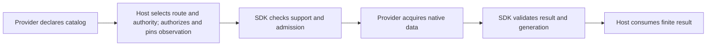

# Resource SDK v1 → v2: what changes, and how provider-neutral is it?

**Status:** PR21 is a breaking resource-API candidate, not an accepted public contract. This overview compares the legacy resource APIs at `32a3358` with the candidate reviewed at `107ea02`. It describes current behavior, not a proposed redesign or permission to merge.

## The short version

The old resource framework asked a plugin to register connection-backed **resourcers**: objects with a six-method Get/List/Find/Create/Update/Delete contract. Resource metadata and several surrounding APIs followed group/version/kind and namespace-shaped conventions.

The new boundary asks a plugin to describe **what exists and what it actually supports**, then implement only those operations. Resource identity is independent of the connection used to reach it. The host owns authority and authorization; the provider owns native acquisition; the SDK validates the boundary and, optionally, manages client lifetimes.

This moves away from Kubernetes-shaped resource registration. It does **not** prove that every new public helper or lifecycle policy is the right general-purpose API. There are still review questions, residual older utility fields, and one reproduced relationship-scope limitation described below.

Here, “v2” means the **resource contract**, not a new version of every SDK package. `pkg/v1/exec`, `logs`, `metric`, `networker`, and other utility packages still exist. Resource wire version `2` is separate from the shared go-plugin protocol version `1` and from the Go module release tag.

## What changes for a plugin author?

| Concern | Legacy resource APIs | Resource v2 candidate |
| --- | --- | --- |
| Minimum implementation | Both legacy Resourcer interfaces require Get, List, Find, Create, Update, and Delete. | Only `Provider.Catalog` is required. A catalog-only provider is valid. |
| Additional functionality | Watches, actions, schemas, relationships, health, and other extensions already had optional interfaces. Not everything was mandatory. | Finite reads, enumeration, native queries, mutations, and actions are also independently optional. |
| Advertised support | The historical v1 registry marks all six core operations supported for a registered Resourcer. Unsupported native behavior can fail later. | A catalog declares support by type and scope; the corresponding implementation must also exist. Create, mutation-update, and delete are separate declarations. |
| Type names | Metadata helpers construct and parse `group::version::kind`; other registration paths can accept raw keys. | Type identifiers are opaque strings. No group/version/kind decomposition is required. |
| Object identity | CRUD inputs use ID/namespace; connection identity also appears in older reference/session structures. | Address = provider + host-issued authority + type + identity scope + opaque ID. Connection is a separate access route. Incarnation is an optional observation. |
| Bodies | The two old stacks use generic maps and/or raw JSON, depending on the API. | One tagged `Value` model carries exact signed/unsigned integers, doubles, timestamps, null, lists, and maps. Resource bodies currently require a map root. |
| Listing and querying | List/Find expose namespace-shaped selection and query/pagination features; historical v1 also has typed filtering and text-search extensions. | `Enumerate` returns finite source pages. Optional `NativeQuery` accepts a provider-defined language and query value. Neither is the final host query engine. |
| Connections | Historical v1 requires a connection provider, including namespace discovery, and can fall back to the first active connection. | Controller/lifecycle support is optional. Client leasing requires an explicit route and an already-started generation; discovery does not start one. |
| Updates | SDK-managed watch/informer machinery and sync policies already exist. | Advisory updates explicitly promise best-effort delivery, not replay or atomic snapshot/live continuity. Zero sync policy still means on-connect; it does not disable a supplied watch. |
| Migration | Two resource stacks coexist: `pkg/resource` and `pkg/v1/resource`. | Both are replaced by `pkg/resource/v2`. Rebuild and migrate consumers; there is no resource-v1 compatibility shim or silent RPC fallback. |

The old framework was not Kubernetes-exclusive: its comments and extension points already contemplated cloud providers and generic partitions. The change is from **Kubernetes-shaped conventions and a mandatory six-method core** to a more explicit provider-neutral boundary—not from “only Kubernetes” to “anything works automatically.”

## What is exposed now?

### Provider authors

- **Required:** `Provider` and its catalog, resource types, representations, dimensions, and scoped capability declarations.
- **Optional acquisition:** `Getter`, `Enumerator`, `NativeQuerier`, `Mutator`, and `Actioner`. Implementing `Mutator` does not imply support for all write verbs. Advisory `OperationUpdate` is not mutation-update.
- **Optional metadata and streams:** schema, presentation, relationships, health, diagnostic events, actions, and best-effort update traits. Providers need not fabricate these capabilities.
- **Optional SDK management:** `NewController`, `Config[T]`, `Registration[T]`, and `Lifecycle[T]`. The client type is provider-defined; a custom provider can skip this controller.
- **Boundary helpers:** exact-value conversion and validation, classified errors, and catalog-generation helpers for custom providers.

Register the resulting provider with `sdk.RegisterResourcePlugin(plugin, provider)`. Providers construct handwritten domain values; they do not need to build protobuf messages for ordinary provider methods.

### Host and integration code

The host assigns authority, authorizes operations, selects explicit connections and representations, and retains the catalog observation used for admission. Session labels and catalog revision tokens are not permission grants.

Connection overlays, readiness inspection, route-qualified observations, and utility connection binding support that integration. They are a larger public surface than the minimum provider interface and remain part of the API review—not requirements prescribed merely by an opaque resource identity model.

### Transport code

`pkg/resource/v2/plugin`, protobuf messages, wire validation, and retained conversion helpers bridge processes. Negotiation, raw-wire checks, independent domain validation, and result/generation fences are intentional. Generated decoding alone cannot preserve every malformed-wire distinction, such as duplicate fields.

The [architecture guide](resource-v2-api.md#export-inventory) separates these audiences in more detail. An exported transport helper is not automatically a recommended provider-author API.

## What happens when the host requests a resource?

When controller lifecycle management is configured, explicit startup creates the native client first. An operation borrows that configured generation. Retirement prevents new leases, cancels old work, drains it, and destroys the client. A late result cannot silently become a result from a replacement connection. A controller without lifecycle management can dispatch callbacks with a nil client; a custom provider can own acquisition without this controller.

A source page is still a provider acquisition result: it can have an opaque continuation, unknown count, or partial coverage. This SDK does not implement history storage, a universal planner, or a durable live-query engine.

Exec/log/metric/forwarding engines remain separate utilities. Resource payloads use canonical values and optional references/routes through explicit resource RPC lanes. **Reference-bearing calls** require catalog admission without an unrelated Get. Body-only calls and ordinary opaque selectors do not need fabricated references or catalog pins; explicit route intent still requires a matching configured connection. Accepted-session lifetimes are **not identical**: asynchronous logs retain the generation-ownership caveat documented in the [utility lifetime section](resource-v2-api.md#utility-and-stream-lifetime).

## Are the “Kubernetes native” references a warning sign?

Some are documentation bias; some older surfaces really remain. They should not all be explained away as examples.

### What this review found in the resource-v2 core

- No Kubernetes client dependency, GVK parser, required namespace field, or mandatory `metadata.name`/`metadata.uid` extraction was found in the production resource-v2 boundary.
- `ResourceType` separately declares identity dimensions and query dimensions. A provider can use account, region, node, repository, or no identity dimensions; namespace is not a reserved universal dimension.
- Resource bodies need not contain Kubernetes `kind`, `apiVersion`, or object metadata. The map-root requirement is a real restriction, but a different one.
- “Native client” means the provider's underlying client. “Native query” means its query language. “Native connection” distinguishes source-owned configuration from host overlays. None of those terms means “Kubernetes client required.”
- Presentation accessors and relationship descriptors are configurable metadata. A fixture containing `metadata.namespace` does not make that a hard-coded identity rule.

An executed `GOWORK=off GOFLAGS= go list -deps ./pkg/resource/v2/...` found no Kubernetes dependency paths. This supports the import claim; it does not establish that the complete API is ideally shaped.

### Why Kubernetes appears so often

The architecture/review documents use the Kubernetes and Helm implementations as integration landmarks. Fixtures also use Kubernetes-shaped documents, namespace dimensions, authority-hint strings, and port-forward examples. Those references explain an exercised integration, not a universal provider requirement. The [architecture guide](resource-v2-api.md) previously made that distinction harder to see by mixing its generic ownership map with concrete integration filenames.

Cloud/container/hypervisor conformance fixtures add useful counterexamples: opaque IDs, account/node scope collisions, missing schemas, unknown counts, exact large numbers, and provider-owned cursors. They run through real disposable plugin processes and gRPC. They remain synthetic fixtures, not proof that production cloud or hypervisor integrations work.

### What has not been fully generalized

- Older metric requests still expose and forward `ResourceNamespace` alongside canonical resource fields. The canonical reference path does not require that selector, but this is real retained utility surface, not merely test text.
- Older common protobuf messages still contain group/version/kind and namespaced-link metadata. They are outside the new resource-v2 messages; SDK-wide removal of every older concept is not claimed.
- Optional labels, health conditions, counted diagnostic events, and cache/sync states retain familiar resource-controller vocabulary. Optionality prevents mandatory Kubernetes metadata, but these shapes still deserve cross-provider design review.
- Extractor field-path/selector interoperability, map-root bodies, create request/result shape, connection overlays, admission helpers, and transport ceilings remain implementation choices to review. Lack of Kubernetes imports does not settle them.

### A concrete portability limitation reproduced during this review

Relationship matching currently assumes that each target query dimension can be recovered from the returned object's identity scope. That is stricter than the model's explicit separation of identity and query dimensions.

A standalone probe called the public `MatchRelationshipTarget` helper:

- Identity scope `account=account-a`, with an account-only target binding: accepted.
- The same identity and binding plus query-only `region:any`: request validation passed, but matching returned `UNSUPPORTED` with `Observed relationship has no unique explicit target binding.`

The matcher synthesizes identity dimensions from the target's query constraints before matching. See [`relationship_validation.go`](../pkg/resource/v2/relationship_validation.go), `matchRelationshipTarget`, and [`controller_admission.go`](../pkg/resource/v2/controller_admission.go), `exactScopeEntries`.

This is a generic scope-model limitation, not evidence of a Kubernetes dependency. It should be resolved before claiming the relationship API covers providers with query-only dimensions. The current neutral fixtures use equal identity/query dimensions, and their hypervisor edge oracle does not exercise relationship-resolution RPCs, so their passing results do not close this gap. No production code or admission semantics were changed as part of this write-up.

## What should be settled before API acceptance?

1. Resolve the relationship query-only-dimension gap without inventing identity coordinates or weakening target admission.
2. Review the minimum provider contract separately from the much broader controller/host integration helper surface.
3. Exercise representative non-Kubernetes acquisition and relationship contracts, including identity/query dimension differences and backend-specific creation semantics.
4. Settle the already-recorded lifecycle/admission/overlay policy and asynchronous log-session ownership decisions. Do not infer their approval from the successful Kubernetes integration or lint/test results.

The direction is more provider-neutral than the old resourcer core. The remaining work is to validate the boundaries against varied providers, not to rename Kubernetes examples and declare the architecture finished.

## Sources and verification

- Current contracts: [domain](../pkg/resource/v2/domain.go), [controller options](../pkg/resource/v2/provider_options.go), [optional traits](../pkg/resource/v2/ancillary.go), [package overview](../pkg/resource/v2/doc.go), and [executable examples](../pkg/resource/v2/example_test.go).
- Legacy snapshots: [required v1 resourcer and optional extensions](https://github.com/omniviewdev/plugin-sdk/blob/32a3358/pkg/v1/resource/resourcer.go), [v1 connection contract](https://github.com/omniviewdev/plugin-sdk/blob/32a3358/pkg/v1/resource/interfaces.go), [capability derivation](https://github.com/omniviewdev/plugin-sdk/blob/32a3358/pkg/v1/resource/resourcer_registry.go), and [older unversioned core](https://github.com/omniviewdev/plugin-sdk/blob/32a3358/pkg/resource/types/resourcer.go).
- Detailed candidate decisions and acceptance limits: [architecture/API guide](resource-v2-api.md), [specification review](resource-v2-spec-review.md), and [provider-neutral conformance receipt](provider-neutral-conformance.md).
- Re-executed for this overview with `GOWORK=off GOFLAGS=`: `go test ./pkg/resource/v2 -run '^Example' -count=1 -v` and `go test ./internal/resourceconformance -run '^TestCurrentSDK(NativeBoundary|IndependentProfiles|HostIssuedAuthority)$' -count=1 -v`. All four examples and the selected real-child conformance cases passed.
- Scope: focused source/history review, compiled import graph, and one standalone relationship-matching reproduction. Not an exhaustive design/security audit or a new live cloud/Kubernetes/hypervisor smoke run. Resource API acceptance remains pending.
