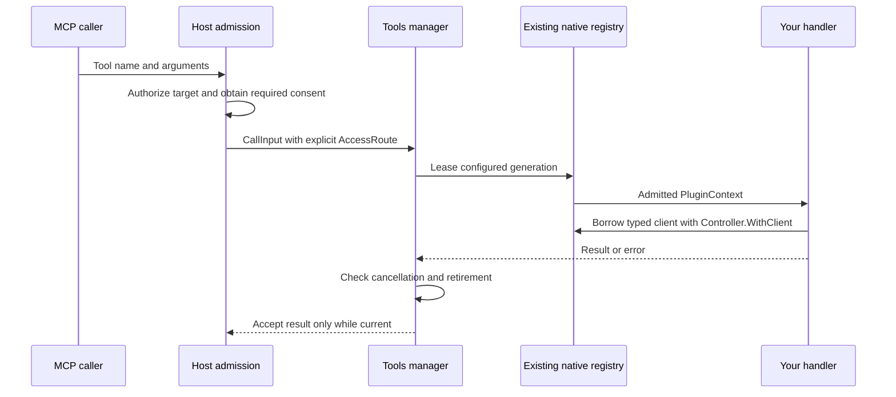

# Expose a custom tool

[Docs home](README.md) · [Capabilities](capabilities.md) · [Resource guide](resources.md)

Use a custom tool for work that is not already a resource operation. The host builds resource tools from the route's catalog; do not wrap Get, enumeration, deletion, or resource logs in another plugin tool.

## Choose the right surface

| Your operation | Author it here |
| --- | --- |
| Read or enumerate resources | Resource catalog and optional provider operations |
| Create, update, or delete resources | Independent resource capabilities and `Mutator` |
| Run an operation on a resource type or instance | Action descriptor and matching action target |
| Read resource logs | Existing logs handler and source engine |
| Inspect the plugin itself or run non-resource work | Custom `tools.Tool` |

Register only capabilities the plugin implements. MCP publication and permission are host decisions, not consequences of registration.

## Use another plugin's connection

Set `Descriptor.ConnectionOwner` to the owner plugin ID and use `ScopeConnection`. Declare the required operations and resource types in the consumer manifest. The owner must export the same access. See [connection grants](connections.md#share-connection-access).

Inside the handler, call `hostconnections.FromContext(pc.Context)`. Use this client for catalog discovery, target resolution, schema documents, Get, Enumerate, and conditional Update. Update requires `Operation: "update"` and a nonempty expected revision.

The host supplies the selected route and a call-scoped delegation token. The SDK rejects missing tokens and missing callback bindings before the handler runs. The callback client rejects owner and route substitution before transport. The host enforces grants, target identity, call lifetime, and policy for every callback.

The callback does not transfer the owner's connection profile or native client. Do not put credentials in tool arguments or error messages. A callback binding lasts for one plugin process and closes at shutdown. Rebinding is not permitted.

Hosts dispense the standard `lifecycle.Plugin` to obtain a lifecycle client with the process broker. Call `ServeHostConnections(ctx, service)` to register and bind a bounded callback server. This helper requires host connections version 1 and returns an idempotent stop function. Call stop when the consumer process or its grants retire. The context limits binding only; it does not own the accepted server's lifetime. The host service must bind caller identity to that consumer process.

A binding error can occur after remote acceptance. Retire the consumer process after a binding error. Do not retry a binding with an uncertain result.

## Register a connection-free tool

This entrypoint assumes an installed `notes` manifest, as described in the [quickstart](quickstart.md#installation-and-launch-boundary). Add `tools` to that manifest's capabilities without removing its other capabilities.

```go
package main

import (
    "encoding/json"
    "log"

    "github.com/omniviewdev/plugin-sdk/pkg/sdk"
    "github.com/omniviewdev/plugin-sdk/pkg/types"
    "github.com/omniviewdev/plugin-sdk/pkg/v1/tools"
)

func main() {
    plugin := sdk.NewPlugin(sdk.PluginOpts{ID: "notes"})
    readOnly := true

    err := tools.RegisterPlugin(plugin, tools.PluginOpts{
        Tools: []tools.Tool{{
            Descriptor: tools.Descriptor{
                Name:        "version",
                Title:       "Plugin version",
                Description: "Return this plugin's implementation version.",
                Scope:       tools.ScopePlugin,
                InputSchema: tools.ObjectSchema(nil),
                OutputSchema: tools.ObjectSchema(map[string]any{
                    "version": map[string]any{"type": "string"},
                }, "version"),
                Annotations: tools.Annotations{ReadOnly: &readOnly},
            },
            Handler: func(_ *types.PluginContext, _ json.RawMessage) (*tools.Result, error) {
                return tools.JSONResult(map[string]any{"version": "development"})
            },
        }},
    })
    if err != nil {
        log.Fatal(err)
    }
    plugin.Serve()
}
```

A plugin-scoped call has no connection. Supplying a route or selected connection metadata is an error; the SDK does not choose a default connection.

## Use an admitted native connection

Choose `tools.ScopeConnection` only when the operation needs a configured native connection.



The host supplies `CallInput.Route`. Plugin authors do not reconstruct that route from user arguments or serialize their own protobuf request.

Inside the handler:

1. Use the admitted `PluginContext` and its cancellation context.
2. Borrow the client through the resource provider's existing typed `Controller.WithClient`.
3. Finish native work before returning. Do not retain the borrowed client or callback context for background work.
4. Return the native error or an object-valued result. The SDK owns final cancellation and retirement checks.

The configured registry replaces caller-supplied connection profile data. A missing, stopped, or retired connection fails before native handler work. A custom tool does not need a fabricated resource reference or catalog pin.

An accepted asynchronous utility session has a different lifetime. Use the existing session capability rather than starting an unowned goroutine in a tool callback.

## Define input and output honestly

`InputSchema` and any `OutputSchema` must describe JSON objects. `StructuredContent`, when present, must also be an object. Use text content for results that are genuinely text rather than wrapping a scalar as invalid structured content.

Schemas use the SDK's bounded JSON Schema 2020-12 profile:

| Concern | Contract |
| --- | --- |
| References | Static local pointers and anchors only; no network loading or recursive/dynamic references |
| Dialect and formats | Other dialects and `format` keywords are rejected |
| Defaults and coercion | Never applied |
| JSON | Duplicate members are rejected at every depth; numbers stay exact |
| Validation | Input before native admission; declared structured output before success |
| Resource bounds | 1 MiB per schema/value, 10,000 nodes, depth 128, plus schema-expansion and validation-work budgets |

See [the complete bounded profile](capabilities.md#choose-capabilities) for numeric and work limits. Unsupported declarations fail registration; unsupported work fails validation rather than silently dropping assertions.

Consumers inspecting tool metadata can call `tools.ValidateDescriptor(descriptor)`
before publication or schema transformation. It uses registration's same bounded
profile for both input and any declared output, requires no handler, and does not
rewrite the descriptor or execute native work. Its diagnostics are local errors,
not safe model-facing messages.

## Treat annotations as hints

Annotation booleans are optional pointers. Omission and explicit false remain distinct across the wire.

| Hint | Omitted value |
| --- | --- |
| `ReadOnly` | `false` |
| `Destructive` | `true` |
| `Idempotent` | `false` |
| `OpenWorld` | `true` |

Use `Annotations.Resolve()` when consuming hints. A read-only annotation does not authorize execution or waive host consent. MCP custom tools require explicit user policy enablement; resource-read presets rely on host-known resource operations instead.

## Return safe failures

Return context cancellation and deadline errors normally. They remain transport failures.

Classified `TIMEOUT` errors return a safe tool failure. Other reviewed codes are `EXECUTION_FAILED`, `UNAVAILABLE`, `PERMISSION_DENIED`, `GRANT_DENIED`, `CONNECTION_NOT_STARTED`, `OWNER_UNAVAILABLE`, `DELEGATION_NOT_ACTIVE`, `CONFLICT`, and `UNSUPPORTED`.

Failure results contain only the reviewed code and fixed public text. Raw diagnostics and structured failure content do not cross this boundary. Keep diagnostic causes in the local error wrapper.

Retirement or timeout can reject a result after a native side effect has started. That rejection does not prove rollback. Do not automatically retry writes.

## Migrate callers together

The tools service uses only `omniview.sdk.tools.v2` and contract version 2. Existing Go utility package paths remain unchanged; the service namespace is the wire contract.

Older metadata-only peers do not receive a fallback call. Upgrade the SDK and host consumer together through the reviewed candidate cohort. Do not assume an older published SDK tag contains these APIs.
